# 03 — System Architecture

This document covers the system architecture, how components communicate, every major workflow (as Mermaid diagrams), where LangGraph is useful and where it isn't, and an evaluation of MCP.

Related documents: agents ([AI agents](3-ai-agents.md)), database ([Database](4-database.md)), API ([API](5-api.md)), security ([Security](6-security.md)), AWS ([AWS & costs](../4-plan/2-aws-and-costs.md)).

---

## 1. Architectural style

SENTINEL is a **modular monolith in Python**, deployed as a few processes that share one codebase and one PostgreSQL database. A separate, minimal **privileged runner** service is the only component allowed to talk to the container engine. All containers run on **rootless Podman** ([ADR-0018](../adr/0018-podman-runtime.md)).

Why not microservices? There is one developer, one database, and no independent scaling needs. Microservices would add network failure modes, deployment overhead, and cost without any benefit. The *monitored demo app* is multi-service because SENTINEL needs distributed traces to analyse. SENTINEL itself does not need to be. See [ADR-0001](../adr/0001-modular-monolith.md).

## 2. Component overview

*Revision 2:* monitored systems, including the AVIRO demo, are **external** to SENTINEL. They connect through integrations into one ingestion gateway. The full integration design is in [14-integration-architecture.md](2-integrations.md).

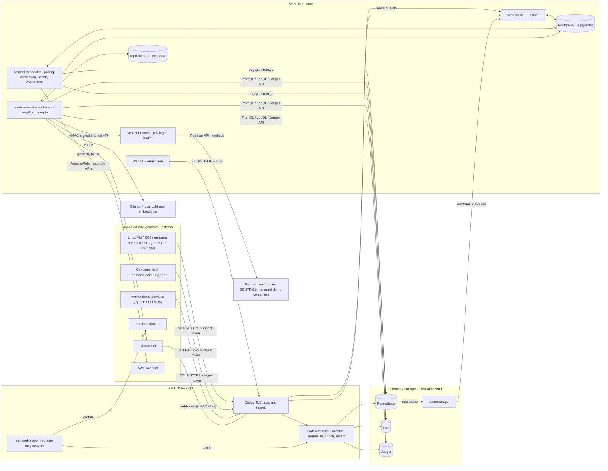

### Processes

| Process | Responsibility | Runs LLM? | Privileges |
|---|---|---|---|
| `sentinel-api` | REST API, auth, SSE, webhooks (Alertmanager, deployments, GitHub) | No | DB read/write (app role) |
| `sentinel-scheduler` | Periodic tasks: Loki error polling and fingerprinting, signal correlation, integration health and staleness, check-in evaluation, entity discovery, pull-connector polling (AWS, Should), approval expiry, repo sync triggers | No | DB, read-only telemetry, connector credentials (read-only roles) |
| Gateway OTel Collector | Receives all pushed OTLP after Caddy auth. Sets identity attributes from the token. Normalises (OTTL), redacts, guards cardinality, exports to Prometheus, Loki, and Jaeger | No | Internal network. Write access to telemetry stores only |
| `sentinel-prober` | External HTTP, TCP, and TLS checks with an SSRF guard. Emits OTLP to the gateway | No | **Own egress-only network.** Cannot reach internal services |
| `sentinel-worker` | Job execution: investigations (LangGraph), code repair, reports, embeddings, approved action execution | Yes (via gateway) | DB, telemetry read, GitHub token (read; write token only inside the action executor), runner client |
| `sentinel-runner` | Allowlisted Podman operations: sandbox test runs, restart or roll back allowlisted demo containers | No | **Rootless Podman API socket** (dedicated unprivileged user). Internal network only. HMAC-authenticated |
| Ollama (native on Mac; container or native on EC2) | LLM and embedding inference | — | No internet needed after model pull |

On macOS, **Ollama runs natively, not in a container**. Containers run inside the `podman machine` Linux VM, which cannot use Metal the way native Ollama does, so in-container inference would be several times slower. Containers reach it at `host.containers.internal:11434`.

### Inter-component communication

| From → To | Mechanism | Notes |
|---|---|---|
| Browser → API | HTTPS JSON (REST), SSE for live progress | Session cookie (HttpOnly, Secure, SameSite=Strict) plus CSRF header |
| Agents and OTel SDKs → gateway | OTLP over HTTPS (gzip) to `ingest.<domain>`. **Outbound only** from the monitored system | `Authorization: Bearer <ingest token>`. Caddy `forward_auth` → `sentinel-api /internal/ingest-auth` maps the token to the integration, applies rate limits, and records last-seen |
| Prober → gateway | OTLP over the internal network | Prober's own integration identity |
| Cron jobs → API | `POST /api/v1/ingest/checkins/{token}` (Should) | Unguessable per-monitor token |
| Scheduler → cloud APIs | AWS SDK via STS AssumeRole + ExternalId (Should) | Read-only role in the user's account |
| Alertmanager → API | HTTP webhook | `X-Sentinel-Key` scoped API key |
| CI / deploy script → API | `POST /api/v1/ingest/deployments` | API key with `deployments:write` scope |
| GitHub → API (optional) | Webhook with HMAC signature | Push events trigger a repo sync |
| API / scheduler → worker | **Postgres job table** (`SELECT … FOR UPDATE SKIP LOCKED`) plus `LISTEN/NOTIFY` wake-up | No Redis or Celery needed for SENTINEL ([ADR-0006](../adr/0006-postgres-job-queue.md)) |
| Worker → UI progress | Worker writes `investigation_steps`. API streams them over SSE (tails rows plus NOTIFY) | Reconnect uses `Last-Event-ID` |
| Worker → telemetry | HTTP: Prometheus `/api/v1/query_range`, Loki `/loki/api/v1/query_range`, Jaeger `/api/v3/traces` | Typed adapters with timeouts and result-size caps |
| Worker → Ollama | HTTP `/api/chat` with JSON-schema `format`, `/api/embed` | Through the `llm` gateway module only |
| Worker → runner | HTTP on the internal Podman network, HMAC-signed request body, nonce plus timestamp | The runner never accepts free-form commands |
| Worker → GitHub | REST API (httpx) plus `git` CLI over HTTPS for mirrors | Rate-limit aware |

## 3. Backend architecture (Python package layout)

```
backend/src/sentinel/
  api/            FastAPI routers, dependencies (authN/Z), schemas (Pydantic), SSE
  auth/           password hashing, sessions, RBAC policy, API keys
  db/             SQLAlchemy models, session mgmt, repositories, Alembic migrations
  jobs/           Postgres job queue: enqueue, claim, retry, worker loop, scheduler loop
  telemetry/      adapters: prometheus.py, loki.py, jaeger.py (+ fixtures replay adapter)
  ingestion/      alertmanager webhook parsing, deployment events, github webhooks
  detection/      fingerprinting, error-group tracking, correlation, severity rules
  incidents/      incident lifecycle service, timeline
  evidence/       evidence model, collectors, redaction, deploy before/after comparison
  llm/            gateway (Ollama client), structured output, prompt templates, call logging
  investigation/  LangGraph graphs: rca_graph.py, code_subgraph.py; nodes; state; validators
  code_intel/     repo mirror, git ops, traceback parser, ripgrep search, commit scoring
  repair/         repair graph, patch apply/validate, runner client
  actions/        action catalog, policies, approval service, executor, adapters (github, runner)
  memory/         embeddings, similarity search, resolution capture
  reporting/      report builder (deterministic facts + LLM narrative), markdown renderer
  security/       redaction rules, prompt-injection guards, audit log writer
  observability/  SENTINEL's own OTel instrumentation
  config.py       pydantic-settings
  cli.py          `sentinel api|worker|scheduler|migrate|seed|eval`
```

Layering rule: `api` → services (`incidents`, `investigation`, `actions`, …) → `db` repositories and adapters. Only `investigation`, `repair`, and `reporting` import `llm`. **No module that holds credentials for state-changing operations (`actions.executor`) is reachable from LLM node code.** An import-linter contract in CI enforces this.

## 4. Frontend architecture

- **Vite + React 19 + TypeScript** single-page app ([ADR-0011](../adr/0011-vite-react-spa.md)). Next.js adds SSR and a Node server, which SENTINEL does not need.
- **TanStack Query** for server state, **React Router** for routing, **Tailwind CSS + shadcn/ui** (Radix primitives) for components, **Recharts** for metric evidence charts, **react-diff-view** for patches.
- API client types are **generated from FastAPI's OpenAPI schema** (`openapi-typescript`), so frontend and backend contracts cannot drift silently.
- **No `dangerouslySetInnerHTML`.** Log lines, code, and LLM text are rendered as text. Markdown (reports) is rendered with `react-markdown` with raw HTML disabled. Logs can contain attacker-controlled content.
- Pages: Login · Incidents list · Incident detail (timeline, signals, evidence, hypotheses, actions) · Investigation live view · Patch review · Approvals queue · Reports · Services & repos (admin) · Users & API keys (admin) · Audit log (admin) · Evaluation results (read-only).
- Served as static files by **Caddy**, which also reverse-proxies `/api` to `sentinel-api` and terminates TLS.

## 5. Observability architecture and ingestion pipelines

SENTINEL does **not** build its own time-series or log store. It relies on proven open-source backends and *queries* them during investigations ([ADR-0007](../adr/0007-observability-backends.md)).

*Revision 2:* every source enters through the **ingestion gateway** ([Integrations §3](2-integrations.md#3-common-integration-architecture)). On the monitored side, host-level data is collected by the SENTINEL Agent and app-level data by OTel SDKs.

| Signal | Path | Retention (MVP) |
|---|---|---|
| Logs | App (OTel SDK logging, JSON) **or** agent (`journald`, `filelog`, container log files) → OTLP/HTTPS → Caddy auth → gateway Collector (identity, OTTL normalisation, redaction) → Loki OTLP endpoint (labels: `service_name`, `host_name`, `sentinel_integration_id`, `level`; trace_id as structured metadata) | 7 days |
| Metrics | App (OTel SDK) **or** agent (`hostmetrics`, `docker_stats` against the Podman/Docker API, `postgresql`, local Prometheus scrape) **or** prober/connectors → gateway → **Prometheus OTLP receiver** (pinned name translation; resource attributes promoted to labels) | 15 days |
| Traces | App (OTel auto-instrumentation: FastAPI, httpx, SQLAlchemy, Celery) → agent or gateway (tail sampling: keep all error traces plus 10% of the rest) → Jaeger v2 (Badger storage) | 2 days |
| Events | Webhooks, check-ins, connector change events, probe and integration state changes → `SentinelEvent` → Postgres `events` | 90 days |

**Evidence is snapshotted.** When SENTINEL uses telemetry as evidence, it stores a redacted, size-capped copy in Postgres. Investigations and reports therefore stay verifiable after telemetry retention expires, and evaluation can replay them.

### Log ingestion pipeline

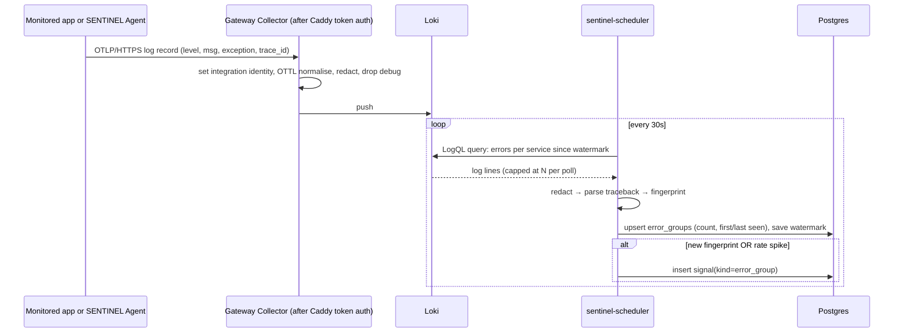

### Metrics ingestion pipeline

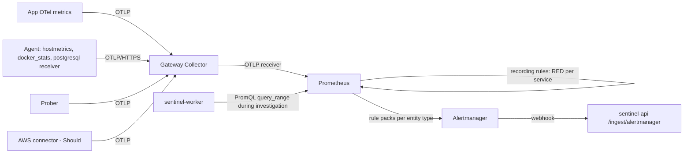

### Trace ingestion pipeline

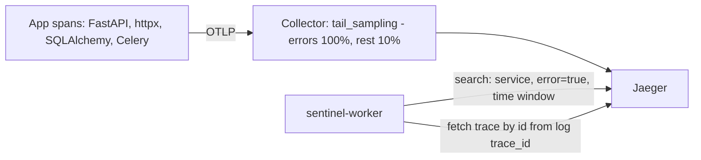

## 6. Incident detection workflow

Detection is **deterministic Python plus Prometheus rules. No LLM is involved.** It must be fast, cheap, explainable, and testable.

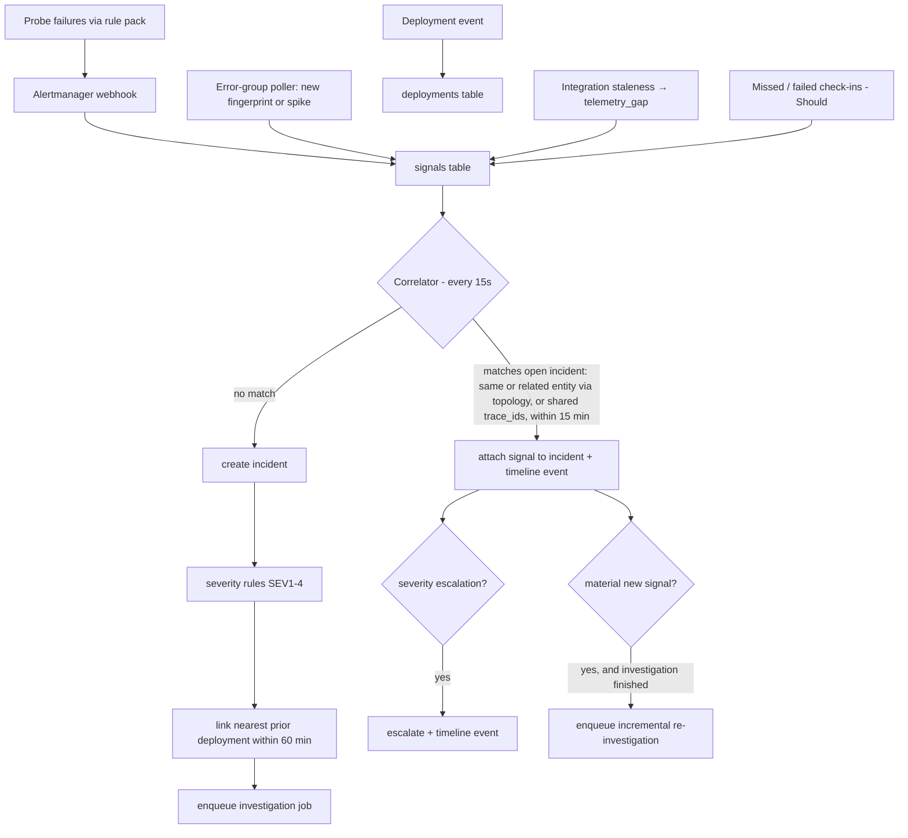

Incident lifecycle: `open → investigating → mitigated → resolved → closed`, with `false_positive` available from any state. Transitions are enforced by a state machine and every transition produces a timeline event.

## 7. Root-cause analysis workflow (LangGraph)

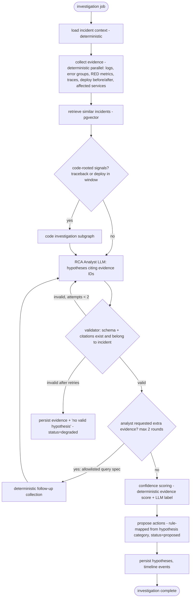

Key properties:
- **Evidence first, then reasoning.** The LLM never pulls telemetry directly. It receives a compact, redacted evidence digest and may *request* follow-ups in a constrained JSON schema (`{"kind":"logs","service":"payments","window_minutes":10,"filter":"timeout"}`). Deterministic code validates the request and executes it.
- **Checkpointed** with `langgraph-checkpoint-postgres`, so a crashed worker resumes from the last node.
- **Budgets:** at most 2 follow-up rounds, at most 6 LLM calls, and a wall-clock timeout (configurable; 10 min local, 30 min AWS).

## 8. Code investigation workflow

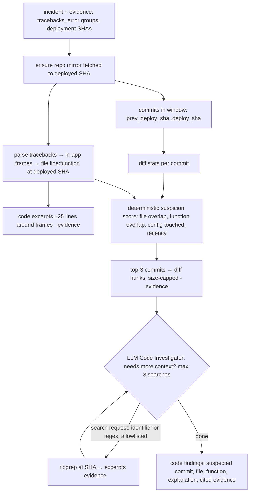

## 9. Code repair workflow

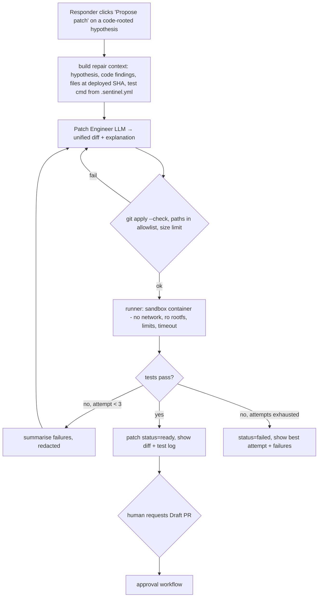

## 10. Human approval workflow

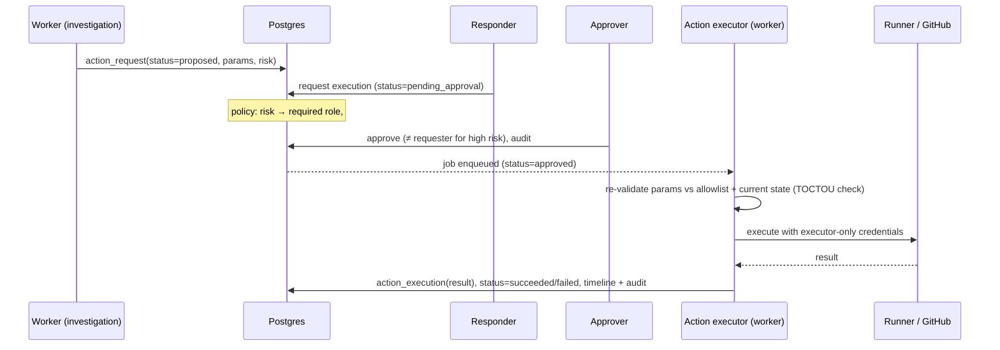

The LLM can only create `proposed` requests, using action types and parameters that are schema-validated against the action catalog. Only humans move a request to `pending_approval` and `approved`. Low-risk actions such as `create_github_issue` still require a single human click. Nothing executes without a human.

## 11. Incident memory and retrieval

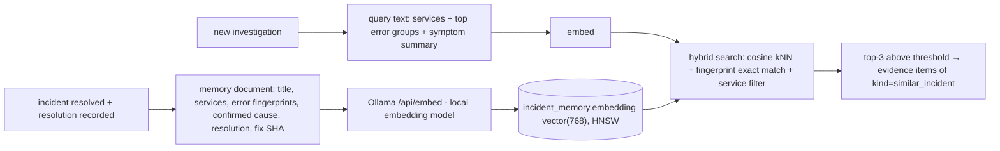

Exact fingerprint matches are more reliable than embeddings, so hybrid scoring weights them heavily. Embeddings catch paraphrased or variant errors.

## 12. Security boundaries

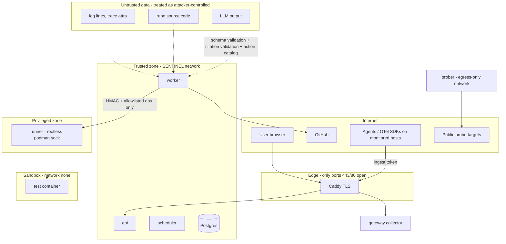

Details are in [07-security-architecture.md](6-security.md).

## 13. Container execution sandbox (rootless Podman)

Each test run gets a fresh rootless Podman container, created by the runner from a pinned image (`sentinel-sandbox-python:3.12`, with the repo's dependencies preinstalled at image build time, because the sandbox has no network):

| Control | Setting |
|---|---|
| Network | `network_mode: none` |
| Filesystem | `read_only: true` rootfs. Workspace is a copy of the patched tree in a tmpfs or a dedicated volume deleted afterwards. `/tmp` tmpfs `noexec` where possible |
| User | non-root UID 10001. `no-new-privileges` |
| Capabilities | `cap_drop: ALL` |
| Resources | `cpus: 1.0`, `mem_limit: 1g`, `memswap = mem`, `pids_limit: 256`, ulimits for nofile and fsize |
| Time | Hard timeout 300 s. Container killed and removed |
| Mounts | No container-engine socket, no host paths other than the ephemeral workspace |
| Runtime | Rootless Podman (user namespaces) with the default seccomp profile everywhere. gVisor `runsc` as the OCI runtime on AWS (Should) |
| Output | stdout/stderr capped at 256 KB, redacted before storage or LLM use |

The command comes from the repository's `.sentinel.yml`, which is validated against a small allowlist (`pytest`, `python -m pytest`, `make test`). **The LLM never supplies a command.**

## 14. Where LangGraph is useful and where plain Python is better

| Concern | Choice | Reason |
|---|---|---|
| RCA investigation (multi-step, conditional, bounded loops, resumable) | **LangGraph** | Explicit state graph, conditional edges, Postgres checkpointing, step streaming, and easy node-level testing with a fake LLM |
| Code repair loop (generate → test → revise) | **LangGraph** | Bounded cyclic workflow with persisted state per attempt |
| Code investigation (tool loop with a small budget) | **LangGraph subgraph** | Same state, checkpointing, and observability as RCA |
| Report narrative | Plain Python + one LLM call | Single call. A graph adds nothing |
| Ingestion, fingerprinting, correlation, severity | **Plain Python** | Deterministic, high-volume, must be unit-testable and fast |
| Evidence collection | **Plain Python** (called from a graph node) | Deterministic queries. Parallelised with `asyncio.gather` |
| Approval workflow and action execution | **Plain Python state machine** | Security-critical. Must not be LLM-driven. Simple explicit transitions |
| Job queue and scheduling | **Plain Python** on Postgres | Small, well understood, no extra infrastructure |
| Embedding and similarity search | **Plain Python** + pgvector SQL | Just a query |

We use LangGraph's **core graph API** (`StateGraph`) and avoid its higher-level prebuilt agents. That keeps control flow explicit and reduces exposure to API churn. LangChain model wrappers are **not** required. The LLM gateway calls Ollama directly with `httpx`, so structured output, timeouts, and logging stay under our control.

## 15. MCP evaluation for the first release

**Decision: MCP is not used inside SENTINEL in v1.0.** A read-only MCP server is a **Could Have** after the core works. See [ADR-0005](../adr/0005-no-mcp-in-v1.md).

| Question | Assessment |
|---|---|
| Do our tools need to be discoverable by external, unknown agents? | No. All tools are internal, known at build time, and called by our own graph |
| Would MCP improve safety? | No. Safety comes from schema validation, allowlists, and approvals in our own code. An MCP hop adds a process boundary but no policy |
| Would it help local small models? | No. Small local models are more reliable with **constrained JSON output against a fixed schema** than with generic tool-calling protocols |
| Cost of adopting | Extra protocol layer, extra processes, harder testing, more attack surface |
| Where MCP *is* genuinely useful | Exposing SENTINEL's incidents and evidence **outward** to developer tools (IDE assistants) as a read-only server. That is real interoperability value, and it is listed as P14 (Could) |

Internally, tools are plain typed Python functions behind a small `Tool` interface (name, Pydantic input schema, permission tag). If MCP is adopted later, exposing that interface over MCP is a thin adapter.

## 16. Integration architecture (summary)

Details are in [14-integration-architecture.md](2-integrations.md). In brief:
- **Methods:** agent (packaged OTel Collector), OTel SDKs, exporters inside the agent, webhooks, external probes, pull connectors, job check-ins, and manual uploads.
- **One pipeline:** everything is normalised at the edge to **OTLP + semantic conventions** (telemetry) or **`SentinelEvent`** (events). Detection, correlation, and the AI are source-agnostic.
- **Identity:** per-integration, write-only ingest tokens. The gateway overwrites `sentinel.integration.id`.
- **Entities and topology:** hosts, containers, services, databases, endpoints, jobs, cloud resources, and repositories, with relations. These drive rule packs, correlation, and evidence collection.
- **Health:** last-seen per integration and signal, agent self-telemetry, `telemetry_gap` signals with disambiguation.
- **Data-only agent:** SENTINEL never executes commands on monitored hosts in v1. Actions are limited to GitHub and SENTINEL-managed demo containers.

## 17. AWS deployment architecture

See [09-aws-deployment-and-cost.md](../4-plan/2-aws-and-costs.md) for the infrastructure diagram, sizing, and costs. In summary: a single Graviton EC2 instance runs the full Podman Compose stack (SENTINEL, observability stack, demo app, Ollama on CPU with a small model) behind Caddy TLS. Backups go to S3. Admin access is through SSM Session Manager, with no SSH. Infrastructure is defined with OpenTofu.
