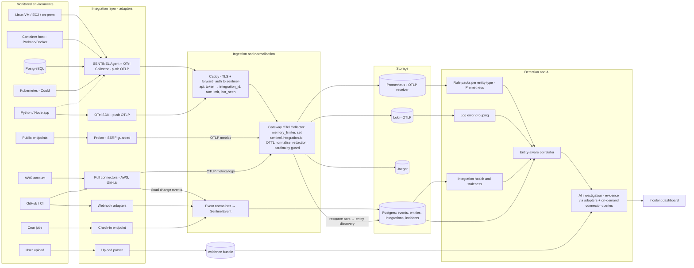
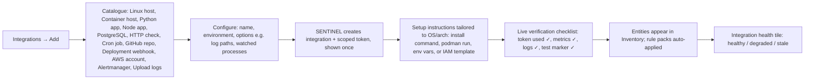

# 14 — Integration Architecture

**Question this document answers:** how does SENTINEL get the information it needs from systems it does not run? Examples are a Linux VM on EC2 or on-prem, a Podman or Docker host, a Python API, a database, a cron job, a GitHub pipeline, or a cloud account.

**Short answer:** through a **small number of integration methods that all feed one OpenTelemetry-based ingestion pipeline**. SENTINEL does **not** write its own monitoring agent. Its "agent" is a SENTINEL-configured, pinned distribution of the open-source **OpenTelemetry Collector**. Systems that cannot run an agent are covered by external health checks, cloud API connectors, webhooks, job check-ins, and manual diagnostic uploads. Each of these has different visibility, and the product says so honestly.

Related: architecture [Architecture](1-system-architecture.md), security [Security](6-security.md), roadmap [Roadmap](../4-plan/1-roadmap.md), ADRs [0013–0017](../adr/README.md).

---

## 1. Integration methods: what each can and cannot see

### A. Monitoring agent (SENTINEL Agent = packaged OpenTelemetry Collector)
A process installed on the monitored machine. It **reads locally** and **pushes outbound** over HTTPS (OTLP) to SENTINEL.

| Can provide | Cannot provide |
|---|---|
| CPU, load, memory, swap, filesystem usage and inodes, disk I/O, network I/O and errors (`hostmetrics` receiver) | Anything when the host is fully down or the agent is stopped. SENTINEL then sees *silence*, not a cause |
| Per-process CPU and memory for **configured** processes. Process presence ("is `gunicorn` running?") | Physical disk health (SMART). Not exposed on cloud VMs (EBS, etc.). Needs `smartctl`, root, and bare metal. Out of scope |
| Application log files (`filelog`), systemd journal (`journald`), syslog | Application internals (requests, traces) unless the app is instrumented (method C) |
| Podman and Docker container CPU, memory, restarts, and logs (`docker_stats` against the Podman or Docker API, container log files or journald) | Hypervisor and cloud-provider events (instance retirement, failed status checks). Use method B |
| Local scrape of Prometheus endpoints and exporters, local DB metrics (method D runs *inside* the agent) | External reachability (DNS, TLS, firewall). Use method F |
| A local OTLP endpoint (`localhost:4317/4318`) for apps on the same host | |

### B. API integrations (pull connectors)
SENTINEL calls a provider's API with credentials the user grants.

| Can provide | Cannot provide |
|---|---|
| Cloud resource inventory and state (EC2 instances, status checks, tags) | OS-level detail beyond what the provider exposes (memory and disk inside an EC2 VM are not in CloudWatch by default) |
| Provider metrics (CloudWatch CPU, network, EBS, RDS, ALB 5xx) at 1–5 min granularity | High-resolution or real-time data. API polling is minutes, and **costs the user money per request** (CloudWatch GetMetricData) |
| **Change events** (CloudTrail: security group changed, instance stopped, scaling) | Application logs, unless they are already shipped to CloudWatch Logs |
| Repository and deployment history (GitHub API) | |
| Querying an **existing** Prometheus or Loki the user already runs ("datasource mode") | |

### C. OpenTelemetry (app instrumentation)
Apps use OTel SDKs or auto-instrumentation and export OTLP to the local agent or directly to SENTINEL.

| Can provide | Cannot provide |
|---|---|
| Request rate, errors, latency per route (RED). Distributed traces across services. Structured logs correlated with trace_id. DB and HTTP client spans, exceptions with stack traces | Host and resource state (use A). Anything from uninstrumented code. Data during a total process crash *after* the last export |
| Language support: Python and Node.js auto-instrumentation are mature. Java, Go, .NET also exist | |

### D. Exporters and collectors (scrape adapters)
Existing Prometheus exporters, or Collector receivers for specific software, run **inside the agent** or as a sidecar.

| Can provide | Cannot provide |
|---|---|
| PostgreSQL (`postgresql` receiver: connections, locks, deadlocks, DB size, replication), MySQL, Redis/Valkey, Nginx, RabbitMQ, JVM, and hundreds of community exporters | Query-level causes (which query is slow) without extra config such as `pg_stat_statements` and slow-query logs (via `filelog`) |
| Any app already exposing `/metrics` | Traces or logs |

### E. Webhooks and event integrations (push events)
External platforms POST events to SENTINEL.

| Can provide | Cannot provide |
|---|---|
| Deployments (GitHub, any CI), alerts from Alertmanager, Grafana, or other monitors, GitHub push and workflow events | Continuous telemetry. Events are *facts that something happened*, not measurements |
| The **"what changed?"** context that RCA needs most | Anything the sender doesn't send |

### F. External health checks (synthetic probes, no agent)
SENTINEL itself probes public endpoints from the outside.

| Can provide | Cannot provide |
|---|---|
| Availability (HTTP status, TCP connect), response time, content assertion (body contains / JSON field), **TLS certificate expiry**, DNS resolution | *Why* something is down. Internal state of the target. Anything behind a firewall SENTINEL can't reach |
| The user's real perspective. Detects total outages that silence agents | Private or internal services (unless a probe runs inside that network, which is a Could item) |

### G. Manual diagnostic uploads
A user uploads log files or exports for an investigation.

| Can provide | Cannot provide |
|---|---|
| Point-in-time evidence for a one-off AI investigation: log files, `journalctl` exports, `podman logs` / `docker logs`, tracebacks, optionally a metrics CSV | **No detection.** No continuous monitoring, no baselines, no before/after unless the upload contains it. Quality depends on what was uploaded |

### H. Job check-ins (heartbeat monitors) *(added; fits the "background workers and scheduled jobs" requirement)*
A cron job or worker calls `POST /ingest/checkins/<monitor>` with `start` / `ok` / `fail` (a one-line `curl` in the crontab).

| Can provide | Cannot provide |
|---|---|
| Missed runs, late runs, failed runs, run duration, for jobs on *any* platform with outbound HTTP | Why the job failed, unless paired with logs (A, C) |

### Visibility matrix

| Information | A Agent | B API | C OTel | D Exporter | E Webhook | F Probe | G Upload | H Check-in |
|---|:-:|:-:|:-:|:-:|:-:|:-:|:-:|:-:|
| Host CPU, memory, disk, network | ✅ | ◐ (cloud: CPU and net only) | | | | | ◐ | |
| Process running or crashed | ✅ | | ◐ | | | ◐ (endpoint down) | | |
| Application logs | ✅ | ◐ (if in CloudWatch Logs) | ✅ | | | | ✅ (one-off) | |
| Request RED metrics | ◐ (if app exposes) | ◐ (ALB) | ✅ | ◐ | | ◐ (outside view) | | |
| Distributed traces | | | ✅ | | | | | |
| Database internals | ◐ (via D) | ◐ (RDS) | ◐ (client spans) | ✅ | | | | |
| Container state | ✅ | | | | | | ◐ | |
| Kubernetes state | ✅ (k8s receivers) | ◐ (EKS API) | | | | | | |
| External availability and TLS | | | | | | ✅ | | |
| Deployments and changes | | ✅ (CloudTrail, GitHub) | ◐ (`service.version`) | | ✅ | | | |
| Scheduled job success | ◐ (logs) | | ◐ | | | | | ✅ |
| Works when the host is down | ❌ | ✅ | ❌ | ❌ | ✅ | ✅ | ✅ | ✅ (detects the miss) |
| Install needed on the target | Yes | No (grant IAM) | Code or config change | Yes (in agent) | Config in sender | No | No | One line |

✅ full · ◐ partial · blank = not provided.

## 2. Environment-by-environment coverage

| Environment | How SENTINEL receives information | Methods | Release |
|---|---|---|---|
| **Linux server or VM (on-prem, any cloud)** | Agent via systemd: host metrics, journald, log files, watched processes. Outbound HTTPS only, works through NAT and proxies | A (+F, +C) | **MVP** |
| **AWS EC2** | Agent as for Linux (inside view), plus the AWS connector: EC2 status checks, CloudWatch metrics, CloudTrail change events (outside view, cloud events) | A + B | A: MVP. B: Should |
| Other clouds (Azure, GCP VMs) | Agent works unchanged. Cloud API connectors are not built | A | MVP (agent only). Connectors: Won't (for now) |
| **Container hosts: Podman (primary) and Docker** | Agent on the host (or as a container with `/hostfs` mounted) collects container stats from the engine API (Podman's `podman.socket` provides a Docker-compatible API) through a **GET-only socket proxy**, plus container logs (files or journald). Compose service names become `service.name` through labels | A | **MVP** (Podman is tested first, because AVIRO runs on it) |
| **Kubernetes** | Official OTel Collector Helm chart with SENTINEL values: DaemonSet (kubeletstats, container logs, k8sattributes) and Deployment (k8s_cluster, k8s events) | A + C | Could (documented, tested on `kind`) |
| **Web apps and APIs (public)** | External HTTP probes. Optionally the app's own OTel | F (+C) | **MVP** |
| **Python apps** | `opentelemetry-instrument` auto-instrumentation, OTLP to the agent or the SENTINEL gateway | C | **MVP** |
| Node.js apps | `@opentelemetry/auto-instrumentations-node` | C | Should |
| **PostgreSQL** | `postgresql` receiver in the agent (monitoring role `pg_monitor`), plus slow-query log via filelog | D | Should |
| MySQL | `mysql` receiver | D | Could |
| **Background workers (Celery)** | OTel Celery instrumentation (task spans and errors), queue depth via exporter | C + D | MVP (demo) |
| **Cron / scheduled jobs** | Check-ins | H | Should |
| **GitHub repos and pipelines** | GitHub API (code, commits), webhooks (push, deployment_status, workflow_run), generic deployment webhook for any CI | B + E | **MVP** |
| Existing monitoring (Alertmanager, Grafana alerts, Datadog or New Relic webhooks) | Generic alert webhook mapped to signals | E | Alertmanager: MVP. Others: Could |
| Existing Prometheus or Loki (customer-run) | Datasource mode: SENTINEL queries them directly instead of ingesting | B | Could |
| Windows servers | The OTel Collector supports Windows, but it is untested and has no installer | A | Won't (for now) |
| Systems with no agent and no API | Probes, check-ins, manual uploads | F, H, G | F: MVP. H, G: Should |

## 3. Common integration architecture

The proposed pipeline in the brief, *External environments → Connectors/agents/APIs → Ingestion → Normalisation → Storage → Detection → AI investigation → Dashboard*, **is appropriate**. The key implementation decision is: **normalise everything at the edge into one of exactly two canonical forms**:

1. **Telemetry** (metrics, logs, traces) → **OTLP with OpenTelemetry semantic conventions**. Stored in Prometheus, Loki, and Jaeger.
2. **Events** (deployments, alerts, check-ins, cloud changes, probe state changes, integration status) → **`SentinelEvent`** (a CloudEvents-inspired JSON schema). Stored in Postgres.

Every integration method is just an adapter into one of these two forms. Detection, correlation, evidence collection, and the AI never know or care which integration produced the data.



### 3.1 Why the OpenTelemetry Collector is both the agent and the gateway
- The same software is used at both ends. Its receivers already exist for host, process, journald, file logs, Podman/Docker, Kubernetes, PostgreSQL, MySQL, and Prometheus scraping.
- Prometheus 3 (OTLP receiver), Loki 3 (native OTLP), and Jaeger v2 (built on the Collector) all accept OTLP natively, so there is no translation layer to write.
- It is vendor-neutral and Apache-2.0. Users who already run an OTel Collector can point it at SENTINEL with *zero* SENTINEL-specific software.

### 3.2 Canonical data model (normalisation rules)
| Concern | Canonical form |
|---|---|
| Resource identity | OTel resource attributes: `service.name`, `service.version`, `deployment.environment.name`, `host.name`, `host.id`, `cloud.provider`, `cloud.region`, `cloud.resource_id`, `container.name`, `container.id`, `k8s.*`, `db.system` |
| Source identity | `sentinel.integration.id` and `sentinel.integration.kind`, **set by the gateway from the authenticated token**. Any client-supplied value is overwritten, so tenants or integrations cannot be spoofed |
| Metric names | OTel semantic-convention names (e.g. `system.cpu.utilization`). Prometheus translation is pinned to one strategy. Rule packs are written against translated names |
| Log severity | OTel `SeverityNumber`. Unparsed text severities are mapped by OTTL (`ERROR`, `err`, `E` → 17) |
| Log structure | JSON bodies parsed. Multiline stack traces joined (filelog `recombine`). `trace_id` and `span_id` preserved |
| Timestamps | UTC nanoseconds. Clock skew of more than 2 min vs server time is flagged in integration health |
| Events | `SentinelEvent {id, type: deployment / alert / checkin / cloud_change / probe_state / integration_status, source_integration_id, entity_refs[], occurred_at, received_at, severity?, payload}` |

Non-conforming sources (syslog lines, CloudWatch datapoints, webhook JSON) are mapped to these forms by **their adapter**. Gateway OTTL rules fix common variants (`host` → `host.name`, missing `service.name` → derived from container or unit name).

### 3.3 Entity model and topology
SENTINEL keeps an **inventory of monitored entities**, auto-discovered from resource attributes and explicitly created by probes, check-ins, and connectors:

`host`, `container`, `service`, `database`, `endpoint`, `job`, `cloud_resource`, `repository`, `k8s_workload` (later).

Relationships (`service runs_on host`, `container on host`, `service uses database`, `endpoint fronts service`, `service built_from repository`) are inferred from co-occurring attributes and trace spans (`db.system` and `server.address`), or set manually.

Why it matters: **correlation and RCA become topology-aware.** A disk-full alert on `host-a` and a 5xx spike on `orders` (which `runs_on host-a`) are merged into one incident, and the RCA sees the host evidence as a candidate cause. This replaces the earlier "same service only" correlation.

### 3.4 Detection: rule packs per entity type
Prometheus rules are written generically by label, so they apply to every entity of that type regardless of integration:

| Pack | Example rules (defaults, overridable later) |
|---|---|
| Host | CPU > 90% for 10 min, available memory < 10%, filesystem > 90% **or** `predict_linear` full within 4 h, inodes > 90%, watched process absent, network errors rising |
| Container | Restart count increase, OOM-killed, CPU throttling, memory near limit |
| Service (RED) | 5xx ratio, p95 latency vs baseline, throughput collapse |
| Database | Connections > 85% of max, deadlocks, long-running transactions, replication lag |
| Endpoint (probe) | Down for 2 consecutive checks, latency > threshold, TLS expires within 14 days |
| Job | Missed or failed check-in (evaluated by the scheduler, not Prometheus) |
| Integration | Stale (no data for N min), degraded (export failures reported by the agent's own telemetry) |

### 3.5 Two modes for API connectors: streaming vs on-demand
API connectors such as CloudWatch are **expensive and slow to poll continuously**. Each connector implements two modes:
- `poll()` is low-frequency (5 min), covers only a few key metrics and status checks for detection, and emits OTLP into the gateway. Change events go to `SentinelEvent`.
- `query_for_investigation(entity, window)` is a **lazy, high-detail pull** used only when an investigation needs it. The result is stored directly as evidence.

This keeps the user's API bill low and keeps detection independent of API latency.

### 3.6 Connector interface (one plugin shape for all pull integrations)
```python
class Connector(Protocol):
    kind: str                                   # "aws", "github", "prometheus_datasource"
    config_schema: type[BaseModel]              # non-secret settings (region, repo, ...)
    credential_schema: type[BaseModel]          # role ARN + external id, token, ...
    def test_connection(self) -> ConnectionReport: ...
    def discover_entities(self) -> list[EntityRef]: ...
    def poll(self, since: datetime) -> PollResult: ...                 # OTLP batches + events
    def query_for_investigation(self, entity: EntityRef, window: TimeRange) -> list[EvidenceDraft]: ...
```

## 4. Integration health: how SENTINEL knows a source stopped sending

1. **Gateway-side last-seen (primary).** Every OTLP request passes Caddy `forward_auth` → `sentinel-api /internal/ingest-auth`. That endpoint validates the token and records `last_seen[integration_id][signal_type]` in memory, flushed to Postgres every 30 s. No telemetry query is needed.
2. **Entity-level last-seen.** The scheduler queries Prometheus per `host.name` and `service.name` (`max by (...) (timestamp(...))`), because one integration can report many entities.
3. **Agent self-telemetry.** The Collector exports its own metrics (`otelcol_exporter_send_failed_*`, queue size, dropped records). Rising failures make the integration `degraded`.
4. **Expected-signal profile.** Each integration declares which signals it should send (a host agent sends metrics and logs, but not traces). The UI shows a per-signal checklist.

**States:** `pending` (created, never received) → `healthy` → `degraded` (partial signals or export errors) → `stale` (nothing for 5 min, configurable) → `disabled` / `revoked`.

**Stale ≠ host down.** When an agent goes quiet, SENTINEL emits a `telemetry_gap` signal and disambiguates using other sources:
- the probe for an endpoint on that host is also failing → "host or network likely down" (higher severity);
- the AWS connector reports the instance running and status checks OK → "agent problem" (low severity);
- no other source → "unknown: host or agent".

That reasoning is deterministic, recorded as evidence, and available to the RCA.

## 5. User setup experience

### 5.1 Accounts
SENTINEL v1 is **single-organisation per deployment** (decision D11). "Create an account" means an admin invites users, and public self-sign-up is off. Multi-tenant SaaS (separate customers sharing one SENTINEL) is **Won't for now**. It would need per-tenant isolation in Loki (`X-Scope-OrgID`), Prometheus (which has no native tenancy, so Mimir would be needed), and every table. Integration IDs on all data keep that door open.

### 5.2 Flow


### 5.3 Per-method setup
| Integration | What the user does | Verification |
|---|---|---|
| Linux host / EC2 / container host | Runs the shown installer (pinned version, checksum-verified) or `podman run` (or `docker run`) of the agent image. The token is entered at a prompt or read from a file, so it is not in shell history | The installer writes a unique marker to the journal (`logger sentinel-verify-<nonce>`). The UI ticks when that marker arrives through the log pipeline (proves the log path end to end) and when host metrics arrive |
| Python / Node app | Adds the auto-instrumentation package and sets `OTEL_EXPORTER_OTLP_ENDPOINT` and `OTEL_SERVICE_NAME` (pointing at the local agent or the SENTINEL gateway with a token header) | First span and log with that `service.name` received. Missing `service.name` triggers a warning |
| PostgreSQL | Creates a `pg_monitor` role (SQL shown). Enables the receiver in the agent config (credentials stay on the user's host) | DB metrics received |
| HTTP check | Enters URL, interval, expected status, optional body assertion | An immediate test probe shows the result |
| Cron job | Copies the `curl` check-in line into the crontab. Sets the expected schedule (cron expression) and grace period | First check-in received |
| GitHub | Pastes a fine-grained token (read) and configures the webhook (URL and secret shown) | Repo synced. Test webhook delivery received |
| Generic CI deployments | Adds one `curl` step after deploy | Test event received |
| AWS account | Deploys the shown **CloudFormation template** (read-only IAM role with SENTINEL's account as principal and an ExternalId). Pastes the role ARN | `test_connection` lists instances and confirms permissions |
| Upload logs | Drags files into an incident or "new manual investigation" | Parse summary (lines, time range, detected errors) |

### 5.4 Configuration management
- MVP: the agent config is **generated by SENTINEL** and downloaded at install. Changing it means re-running the installer, which is idempotent. The config hash is reported by the agent, so the UI shows "config out of date".
- Could: **OpAMP** (OpenTelemetry's open agent-management protocol) for remote config and status. It is deliberately not in the MVP, because remote config push is also a remote attack path.

## 6. Security model per method

| Method | Key risks | Controls |
|---|---|---|
| Agent | Stolen token → spoofed or poisoned telemetry, log-borne prompt injection. Agent compromise → host access. Malicious agent binary | **Per-integration, write-only, revocable tokens** (cannot read anything). Gateway overwrites identity attributes. Rate and size limits per token. **Agent is data-out only: no remote command execution, no inbound ports** ([ADR-0016](../adr/0016-data-only-agent.md)). Runs as dedicated non-root user `sentinel-agent` with only `adm` / `systemd-journal` groups. Container-engine access only through a GET-only socket proxy (a raw engine socket, even mounted read-only, allows full control. Rootful Docker means root-equivalent). Pinned release with checksum and cosign signature verification |
| OTel direct from apps | Token in app env. Public OTLP endpoint abuse (DoS, cardinality bombs) | Same tokens. Collector `memory_limiter`. Request body limits in Caddy. Per-integration series and label caps (excess dropped and reported as `degraded`) |
| Exporters (DB) | DB credentials | Credentials stay on the user's host inside the agent config, never sent to SENTINEL. `pg_monitor` least privilege |
| API connectors (AWS) | Long-lived cloud keys, over-broad permissions, confused deputy | **IAM role assumption with ExternalId** (no static keys). Read-only managed policy listed explicitly (`cloudwatch:GetMetricData`, `ListMetrics`, `ec2:DescribeInstances`, `ec2:DescribeInstanceStatus`, `cloudtrail:LookupEvents`). Credentials encrypted. Connector code is unreachable from LLM modules |
| Webhooks | Forged events (e.g. fake deployment to mislead RCA), replay | HMAC signatures (GitHub), scoped API keys, timestamp and replay window, idempotency keys |
| Probes | **SSRF**: users point checks at `169.254.169.254`, `localhost`, internal container hostnames. Abuse of SENTINEL to scan third parties | Prober runs in its **own container on an egress-only network** (no route to internal services). DNS resolved once, then private, loopback, link-local, CGNAT, and metadata ranges are rejected (IPv4 and IPv6). Connections are pinned to the vetted IP (prevents DNS rebinding). Redirects re-validated. Minimum 30 s interval, per-org target cap, short timeouts, no request bodies |
| Check-ins | Forged "OK" pings hiding failures | Per-monitor unguessable URL token, rate limits |
| Uploads | Zip bombs, huge files, malicious content, PII | Size cap (50 MB) and decompression ratio cap, text-only parsing (never executed), archive path traversal guard, redaction, retention (30 days), prompt-injection handling as for logs |
| Gateway endpoint | New public attack surface | Separate hostname `ingest.<domain>`, auth before the Collector, Collector not exposed directly, ingestion separated from the UI API |

**Actions on monitored systems.** Because the agent is data-only, SENTINEL v1 **cannot execute actions on user hosts**. Actions stay limited to GitHub and the SENTINEL-managed demo environment (via the runner). A future AWS-API action path (e.g. EC2 reboot, SSM Run Command) using a *separate* write role plus approval is listed as Could. Remote shell through the agent is **Won't**.

## 7. Costs

### SENTINEL side (your AWS bill)
- The capacity target for the m7g.xlarge MVP (to be **measured** with a load test in Step 33): about **10 hosts, 20 services, 50 probes, ≤ 3 GB logs/day**. The dominant cost is log volume (Loki disk and CPU), not host count.
- About +50 GB EBS (+$4/mo) if real external hosts are onboarded. Ingress to AWS is free.
- Optional **"external monitored host" demo**: a second small instance (t4g.small) running AVIRO plus the agent, which proves real cross-machine monitoring. About **$15–20/mo always-on**, or about $3–5/mo if scheduled.

### Monitored side (the user's bill), shown in the setup UI
- Agent footprint: typically about 50–150 MB RAM and < 2% of one CPU (measured in Step 8 and published).
- Egress from the monitored cloud to SENTINEL: OTLP with gzip. 1 GB/day of raw logs is roughly 0.1–0.2 GB/day on the wire, about $0.30–0.60/mo at ~$0.09/GB.
- CloudWatch API: GetMetricData is about $0.01 per 1,000 metrics requested (verify current pricing). Polling 50 metrics every 5 min is about 432k metrics/mo, about **$4/mo**. That is why polling is minimal and detail is pulled on demand.

### Local development (M4, 24 GB)
Realistic agent testing uses a **Lima Ubuntu VM** (~2 GB) as a "remote" host. With Qwen3 14B loaded (~11.5 GB), macOS (~7 GB), and the Podman VM (~6–8 GB), an extra VM does not fit. VM-based agent tests in Step 8 run **with Ollama stopped**. Day-to-day development runs the agent as a container with `/proc` and `/sys` of the Podman VM mounted at `/hostfs`.

## 8. Build our own agent or use existing collectors?

**Use existing collectors** ([ADR-0013](../adr/0013-otel-collector-as-agent.md)).

| | Own agent (Go/Python) | OTel Collector distribution |
|---|---|---|
| Build effort | Months to reach parity (log tailing with rotation, backpressure, retries, buffering, multiline, journald, container, DB receivers) | Configuration plus installer plus tests: days |
| Reliability and security | New, unaudited code running on users' machines | Widely deployed, CNCF project, signed releases |
| Portfolio value | Shows reinvention | Shows sound engineering judgment and real-world standards. The custom work goes into **normalisation, entity topology, health, and RCA**, where SENTINEL is actually different |
| Lock-in for users | SENTINEL-only | Users can reuse their existing OTel setup |

What SENTINEL *does* build: the installer, config templates, a verification flow, the gateway auth and normalisation, the prober, check-ins, connectors, and health tracking. Later (Should), a **custom slim Collector build** using the OpenTelemetry Collector Builder (OCB) with only the ~15 components needed. That gives a smaller binary and less attack surface than the full `otelcol-contrib`.

**Component maturity varies** (e.g. `journald` and `podman_stats` are not "stable"). The exact component versions and stability levels are pinned and re-checked when Step 8 is implemented.

## 9. Recommended MVP integration strategy

**MVP (Must):**
1. OTLP ingestion gateway with per-integration tokens, normalisation, and enrichment.
2. Integration and entity model, inventory, and integration health and staleness.
3. SENTINEL Agent for **Linux hosts and VMs (incl. EC2, on-prem)** and **container hosts (Podman and Docker)**.
4. **Python** app instrumentation (the demo).
5. **External HTTP/TCP/TLS probes** (the no-agent path).
6. **Webhooks:** generic deployment events, GitHub, Alertmanager.
7. Integrations UI: catalogue, wizard, verification checklist, health.

**Next (Should):** PostgreSQL integration, cron/job check-ins, manual diagnostic uploads, AWS account connector (CloudWatch, EC2 status, CloudTrail), Node.js instrumentation, slim custom Collector build.

**Later (Could):** Kubernetes Helm values, MySQL, datasource mode for an existing Prometheus or Loki, generic third-party alert webhooks, OpAMP remote management, private-network probe agent, AWS API actions.

**Won't (now):** own agent implementation, remote command execution through the agent, Azure and GCP connectors, Windows installer, multi-tenant SaaS.

Why this set gives the best portfolio value: it demonstrates **three fundamentally different visibility models**. These are inside-out (agent and OTel), outside-in (probes), and change events (webhooks), all converging on one pipeline. The demo story is concrete: *"install one command on any Linux box, see it in the inventory, break it, and SENTINEL explains why with evidence"*. The AWS connector (Should) then adds a fourth model, the cloud API, with clear cost awareness.

## 10. Answers to the ten questions

1. **Which methods should SENTINEL support?** All eight (A–H) eventually, as adapters into one pipeline. Not all at once.
2. **Which in the MVP?** Agent (Linux and Podman/Docker containers), OTel for Python, webhooks (deployments, GitHub, Alertmanager), external probes, plus the shared ingestion, normalisation, health, and integrations UI.
3. **Own agent or existing collectors?** Existing: the OTel Collector, packaged and configured by SENTINEL. Possibly a slim OCB build later.
4. **Agent-based and API-based?** Yes. They answer different questions (inside-out vs provider view and change events). API connectors arrive after the agent path (Should), starting with AWS.
5. **Systems that can't install an agent?** External probes, cloud API connectors, OTel straight from the app, job check-ins, webhooks, and manual uploads. The UI states the reduced visibility for each.
6. **Configure and authenticate integrations?** Catalogue wizard → per-integration scoped, write-only token (agents, OTel, webhooks, check-ins), HMAC secrets (GitHub), IAM role and ExternalId (AWS). Credentials are encrypted and never reach the LLM. Tokens are revocable and rotatable.
7. **Normalising formats?** At the edge, into OTLP with semantic conventions (telemetry) or `SentinelEvent` (events). The gateway enforces identity attributes and fixes common variants with OTTL. Entities are derived from resource attributes.
8. **Knowing a source stopped?** Last-seen per integration and signal at the auth gateway, entity-level last-seen in Prometheus, agent self-telemetry, expected-signal profiles, and a `telemetry_gap` signal with disambiguation via probes or the cloud API.
9. **Security risks?** See §6. The biggest are SSRF via probes, token theft leading to telemetry poisoning or prompt injection, cloud credential scope, and the container-engine socket on monitored hosts.
10. **Best value for a portfolio release?** The Linux and container agent, Python OTel, external probes, and deployment webhooks, then the AWS connector. Together they show breadth (several environment types) without building many shallow integrations.
