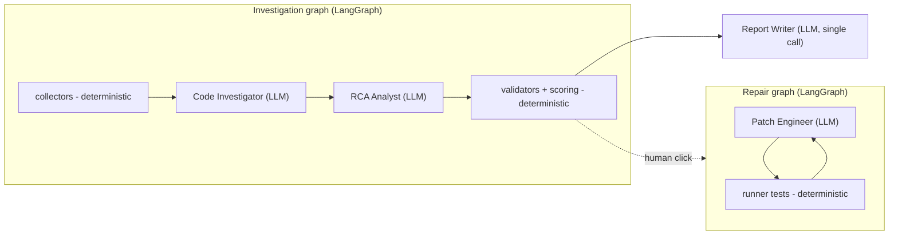

# 04 — AI Agent Architecture

## 1. Design principles

1. **Few agents, many deterministic tools.** An "agent" is justified only when a task needs open-ended reasoning over unstructured evidence. Anything that can be expressed as rules or queries is plain Python.
2. **Evidence before reasoning.** Deterministic collectors gather and store evidence. LLMs reason over a compact digest of that evidence and cite it by ID.
3. **Constrained outputs.** Every LLM call returns JSON validated against a Pydantic schema, using Ollama's JSON-schema `format` (constrained decoding). Free-text is only ever a field inside a schema.
4. **The LLM proposes and code disposes.** LLM outputs are validated: citations exist, paths are in the repo, action types are in the catalog, and parameters match the schema. The LLM holds no credentials and calls no state-changing tool.
5. **Bounded autonomy.** Every loop has a maximum number of iterations, a token budget, and a wall-clock timeout. Failure degrades gracefully: evidence is still shown even when hypotheses fail.
6. **Small-model friendly.** Prompts are short and structured. Each call has one job. Long context is avoided by digesting evidence. Native function-calling is not assumed; "tool use" is a schema field (`requests: [...]`) that our code executes.

## 2. Evaluation of the candidate agents

| Candidate | Verdict | Implemented as |
|---|---|---|
| Monitoring Agent | ❌ Not an agent | Prometheus rules plus the deterministic log poller. Monitoring must be cheap, continuous, and predictable. An LLM adds cost and nondeterminism |
| Incident Triage Agent | ❌ Not an agent | Deterministic correlator plus severity rule table. Triage must be explainable and instant |
| **Root Cause Analysis Agent** | ✅ **Agent: "RCA Analyst"** | LLM node in the investigation graph |
| Log Investigation Agent | ❌ Merged | Deterministic log collector (tool). The RCA Analyst can request extra log queries through a schema |
| Metrics and Trace Analysis Agent | ❌ Merged | Deterministic collectors that compute statistics (before/after deltas, error-propagating spans) |
| **Code Investigation Agent** | ✅ **Agent: "Code Investigator"** | LLM subgraph with a bounded search loop |
| **Code Repair Agent** | ✅ **Agent: "Patch Engineer"** (Should) | LLM node in the repair graph |
| Test Execution Agent | ❌ Not an agent | Deterministic runner call. Executing tests needs no reasoning, and must not be steerable |
| **Incident Reporting Agent** | ✅ **LLM component: "Report Writer"** | Single structured LLM call. Facts are filled deterministically |
| Incident Memory Agent | ❌ Not an agent | Embedding plus pgvector retrieval service |
| Response Approval Agent | ❌ **Must never be an LLM** | Human approval. Policy engine in plain Python |

The result is **3 agents plus 1 single-call LLM component**, orchestrated by **2 LangGraph graphs** (investigation and repair).

## 3. Agent specifications

### 3.1 RCA Analyst

| Aspect | Definition |
|---|---|
| **Responsibility** | Turn an incident's evidence digest into ≤ 5 ranked root-cause hypotheses, each with a causal mechanism, cited evidence IDs, a confidence label, a category, and optional requests for additional evidence |
| **Input** | `IncidentContext` (services, severity, time window, signals), `EvidenceDigest` (≤ ~6k tokens: one line per evidence item `E-12 [log] orders 14:02 KeyError 'currency' ×143` plus key statistics), code findings (if any), similar incidents (if any), previous round's validator feedback |
| **Output** | `RcaResult { hypotheses: [ {title, mechanism, category: enum[code_change, config_change, dependency_failure, resource_exhaustion, infrastructure, data, unknown], evidence_ids: [str], counter_evidence_ids: [str], confidence: enum[high, medium, low], suggested_next_check: str} ], evidence_requests: [EvidenceRequest] (max 3), summary: str }` |
| **Tools** | None directly. It can *request* `EvidenceRequest{kind: logs/metrics/traces/error_group, service, window, filter}`. Deterministic code validates the request (service exists, window ≤ 2h, filter is a plain substring, not raw LogQL) and executes it |
| **Permissions** | Read-only, indirect through validated requests. No network, credentials, or write access |
| **Dependencies** | LLM gateway, evidence store, validators |
| **Failure handling** | Schema violation triggers a retry with error feedback (max 2). Invalid citations are stripped. A hypothesis left with 0 valid citations is dropped. If all are dropped after retries, the investigation is `degraded` and the evidence is still shown. Ollama timeout triggers 1 retry, then the job fails as retryable |
| **Evaluation criteria** | Top-1 and top-3 accuracy against scenario ground truth, MRR, evidence coverage, citation validity (pre-validation, to measure model quality), category accuracy, calibration (accuracy per confidence bucket), latency, tokens |

### 3.2 Code Investigator

| Aspect | Definition |
|---|---|
| **Responsibility** | Given tracebacks, error groups, and the deploy commit window, identify the most likely culprit change and code location, and explain how it could produce the observed error |
| **Input** | Ranked suspicious commits (deterministic score), size-capped diff hunks of the top 3, code excerpts around traceback frames, error messages |
| **Output** | `CodeFindings { suspected_commit_sha, file, function, line_range, explanation, evidence_ids, search_requests: [ {pattern: str (identifier or literal), path_glob} ] (max 3 total rounds) , suggested_fix_prose }` |
| **Tools** | Requested via schema and executed by code: `search_code(pattern, path_glob, sha)` (ripgrep, fixed-string by default, results capped), `read_file_excerpt(path, start, end, sha)` (path must resolve within the repo, ≤ 200 lines) |
| **Permissions** | Read-only on the local repo mirror at the given SHA. No GitHub API calls, writes, or execution |
| **Dependencies** | `code_intel` (mirror, traceback parser, commit scorer), LLM gateway |
| **Failure handling** | Unknown SHA, file, or path → excluded from findings. Path traversal attempts are logged as a security event and ignored. If budget is exhausted, the best findings so far are returned. If no repo is configured, the node is skipped and the RCA proceeds without code evidence |
| **Evaluation criteria** | Culprit-commit top-1 rate, culprit-file accuracy, line-range overlap with ground truth, search-request validity rate, number of rounds used |

### 3.3 Patch Engineer (Should Have)

| Aspect | Definition |
|---|---|
| **Responsibility** | Produce a minimal unified diff that fixes the code-rooted hypothesis, and revise it using test failures |
| **Input** | Selected hypothesis and code findings, full content of up to 3 target files (size-capped), test command, previous attempt diff plus summarised test failures |
| **Output** | `PatchProposal { diff: unified_diff, files_changed: [path], explanation, risk_notes, confidence }` |
| **Tools** | None directly. The graph applies the diff (`git apply --check`) and asks the runner to execute tests |
| **Permissions** | Can only modify files under allowlisted paths (default: the repo's source dirs, not CI config, Containerfiles, `.sentinel.yml`, or `.github/`). Diff ≤ 300 changed lines |
| **Dependencies** | Runner sandbox, code_intel, LLM gateway |
| **Failure handling** | Diff does not apply → regenerate (counts as an attempt). Tests fail → revise (max 3 attempts total). Sandbox timeout → stop and report. Final status `ready` or `failed`, with all attempts stored |
| **Evaluation criteria** | Apply rate, test pass rate within 3 attempts, attempts to pass, diff size, whether the patch touched only expected files, human acceptance (manual label) |

### 3.4 Report Writer (single-call LLM component)

| Aspect | Definition |
|---|---|
| **Responsibility** | Write the narrative summary, impact description, and prevention recommendations of an incident report |
| **Input** | Deterministic report facts (times, severity, services, timeline, actions, status), top hypotheses with evidence, resolution record |
| **Output** | `ReportNarrative { summary, impact, root_cause_statement, prevention: [ {recommendation, rationale, evidence_ids} ] }` |
| **Tools / permissions** | None |
| **Failure handling** | On failure the report is generated with deterministic sections only and the narrative is marked "unavailable". Citations are validated as in the RCA |
| **Evaluation criteria** | Factual consistency check (times, severity, and services mentioned must match the DB; checked automatically by string and number extraction), citation validity, required sections present |

## 4. Shared mechanisms

### 4.1 LLM gateway (`sentinel.llm`)
- `generate_structured(task: str, schema: type[BaseModel], messages, *, model=None, timeout, max_retries) -> T`
- Calls Ollama `/api/chat` with `format=<JSON schema>`, `options.temperature=0.1`, a fixed `seed`, and a configured `num_ctx` (default 16384). Qwen3 "thinking" is configurable per task (on for RCA, off for reports) and measured in evaluation.
- Logs every call to `llm_calls` (task, model, prompt hash, input and output tokens, latency, success, error) and to OTel spans.
- Exposes a `FakeLLM` that returns scripted responses for unit and workflow tests, and a `ReplayLLM` that replays recorded responses for deterministic regression tests.
- The model is configurable per task. The default is one model for all tasks, to avoid swapping models in and out of 24 GB of memory.

### 4.2 Evidence digest and citation contract
- Every evidence item has an incident-scoped ID (`E-1`, `E-2`, …), a kind, a source query, a redacted payload, and a one-line `summary`.
- The prompt includes only summaries plus selected payload excerpts. The model must cite IDs.
- The validator checks that every cited ID exists **for this incident**. It removes invalid IDs, records the count of invalid citations (a model-quality metric), and drops hypotheses with no valid citations.

### 4.3 Confidence model
The displayed confidence is a **heuristic, not a probability**, and the UI labels it as such:
`score = 0.5 * llm_label_weight + 0.5 * evidence_strength`, where `evidence_strength` is computed deterministically. It is the sum of weights for supporting signal types: temporal deploy correlation 0.3, traceback in a changed file 0.3, before/after metric shift 0.2, matching past incident 0.1, trace error origin 0.1. Counter-evidence lowers the score. The evaluation suite measures calibration per bucket, and the weights are tuned on the suite, with a held-out split (see [Testing](../3-quality/1-testing-and-evaluation.md)).

### 4.4 Action proposals
Hypothesis category maps to candidate actions through a rule table, not the LLM. For example, `code_change` with a deployment in the window maps to `rollback_deployment(service, to_version=previous)`, `create_github_issue`, and `propose_patch`. The LLM's role is limited to ranking and explaining. Proposed actions are `proposed`, never executed.

### 4.5 Prompt-injection posture
Logs, traces, code, and commit messages are **untrusted data**. Mitigations, in order of importance:
1. Architectural: the LLM has no state-changing tools, no credentials, and no free-form query capability. Its worst case is a *wrong suggestion*, which a human sees with its evidence.
2. Untrusted content is wrapped in delimited blocks (`<evidence id="E-4" kind="log">…</evidence>`). The system prompt states that the content is data and never instructions.
3. Inputs are normalised: control characters and ANSI escapes are stripped, and excerpts are truncated.
4. Outputs are validated: schema, citations, catalog, and allowlists.
5. Heuristic detection flags evidence containing instruction-like patterns ("ignore previous", "you are now", tool-like JSON) as `suspicious_content` and shows a badge in the UI.
6. An evaluation scenario (S09) measures injection resistance.

## 5. Local model strategy

| Role | Default (decided after the Step 15 benchmark, D2) | Alternatives |
|---|---|---|
| Reasoning (RCA, code, report) | **Qwen3 8B** (Q4_K_M, 6.5 GB loaded at a 16k context) — Apache-2.0 | Qwen3 14B (10.9 GB) where memory allows; it is compared on quality in Step 26. **Qwen3 4B** (about 4.7 GB) on AWS CPU |
| Patch generation | Same model (avoids reloading) | Optionally Qwen2.5-Coder 7B or 14B, if evaluation shows a clear gain |
| Embeddings | **nomic-embed-text v1.5** (768-d, about 0.3 GB) — Apache-2.0 | `bge-m3` (MIT) if multilingual or long input is needed |

The memory budget on the M4 (24 GB), as measured in Step 15 ([benchmark](../benchmarks/models-m4.md)): with the Podman VM (8 GB) running the stack, Qwen3 14B (10.9 GB loaded) pushed about 5.7 GB into swap and generated at about 5 tok/s; Qwen3 8B (6.5 GB) ran at 18.7 tok/s with no swap growth. So the default is 8B (D2), and 14B stays a configuration value for machines with more memory.

Model candidates are compared in Step 15 on **our** evaluation suite, not on public leaderboards. New open-weight releases (for example later Qwen, Mistral, or Gemma versions) can be evaluated by changing a single config value. Licences are checked per model (see [Risks & licences](../4-plan/4-risks-and-licences.md)).
