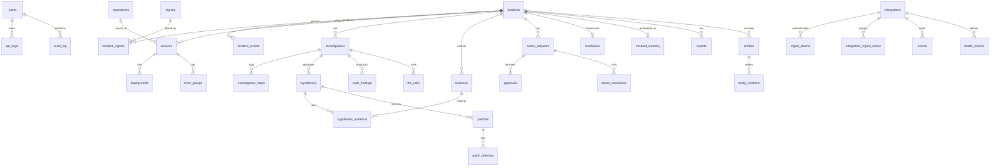

# 05 — Database Design

**Engine:** PostgreSQL 17 with the `pgvector` extension (≥ 0.8) and `pgcrypto`. A single database holds the SENTINEL application data, the job queue, the LangGraph checkpoints (in a separate schema), and the vector embeddings ([ADR-0003](../adr/0003-postgres-pgvector.md)).

**Not stored here:** raw telemetry. That lives in Loki, Prometheus, and Jaeger. Only **redacted, size-capped evidence snapshots** are copied into Postgres.

Conventions:
- Primary keys are `uuid` (v7, time-ordered, generated in the app). `created_at` and `updated_at` are `timestamptz`.
- Human-friendly sequence numbers are used where users refer to things (`INC-42`).
- Enums are Postgres enums managed by Alembic, or `text` with a CHECK constraint where values change often.
- Soft delete is not used. Incidents are closed, not deleted.
- Database roles: `sentinel_migrator` (DDL), `sentinel_app` (DML, **without UPDATE or DELETE on `audit_log`**), `sentinel_readonly` (reporting and evaluation; cannot read `sessions` or `api_keys`). They are created by `scripts/db_roles.sql`, which also installs the extensions (pgvector needs superuser).
- `audit_log` is append-only twice over: the app role lacks the grants, and a trigger rejects UPDATE, DELETE and TRUNCATE for every role, including the table owner.
- Column-level reference: [database.md](../database.md), generated by `make db-docs`.

## 1. Entity relationship diagram

## 2. Tables

### Identity and access
| Table | Key columns |
|---|---|
| `users` | id, email (unique, citext), display_name, password_hash (Argon2id; NULL until an invite is accepted), role enum(`viewer`,`responder`,`approver`,`admin`), is_active, last_login_at, failed_login_count, locked_until |
| `sessions` | id, user_id, token_hash, created_at, expires_at, last_seen_at (idle timeout), revoked_at, ip, user_agent |
| `user_invites` | id, user_id, token_hash, expires_at, used_at, created_by. One-time password-setup links (no public sign-up) |
| `api_keys` | id, name, prefix (first 8 chars, for display), key_hash (SHA-256 with server pepper), scopes text[] (`alerts:write`, `deployments:write`, `github:webhook`), created_by, last_used_at, revoked_at |
| `audit_log` | id bigserial, ts, actor_type enum(user, api_key, system, llm), actor_id, action text, target_type, target_id, details jsonb (redacted), ip, prev_hash, hash (SHA-256 chain) |
| `credentials` | id, kind (`github_read`, `github_write`), encrypted_value (AES-GCM, key from env or secret store), created_by, rotated_at. **Never selected by LLM-facing code paths** |

### Integrations and entities (revision 2)
| Table | Key columns |
|---|---|
| `integrations` | id, name, kind enum(`linux_host`,`container_host`,`otel_app`,`http_check`,`deploy_webhook`,`github`,`alertmanager`,`postgresql`,`checkin`,`aws_account`,`upload`), environment, config jsonb (non-secret; schema per kind), expected_signals text[], status enum(`pending`,`healthy`,`degraded`,`stale`,`disabled`,`revoked`), status_reason, config_hash, created_by, created_at |
| `ingest_tokens` | id, integration_id, prefix, token_hash (SHA-256 + pepper), created_at, last_used_at, revoked_at, rate_limit_per_min |
| `integration_signal_status` | integration_id, signal (`metrics`,`logs`,`traces`,`events`), last_seen_at, last_count_window, last_error. PK(integration_id, signal) |
| `entities` | id, type enum(`host`,`container`,`service`,`database`,`endpoint`,`job`,`cloud_resource`,`repository`), key (canonical identity, e.g. `host.id` or `service.name` + env), display_name, attributes jsonb, integration_ids uuid[], criticality, first_seen, last_seen. UNIQUE(type, key) |
| `entity_relations` | from_entity_id, to_entity_id, relation (`runs_on`,`uses`,`fronts`,`built_from`,`member_of`), source (`inferred`,`manual`), confidence, last_seen |
| `events` | id, type (`deployment`,`alert`,`checkin`,`cloud_change`,`probe_state`,`integration_status`), source_integration_id, entity_ids uuid[], occurred_at, received_at, severity, dedupe_key unique, payload jsonb (redacted) |
| `health_checks` | id, integration_id, kind (`http`,`tcp`,`tls`), target, interval_s (≥ 30), timeout_s, assertions jsonb, enabled, entity_id |
| `checkin_monitors` *(Should)* | id, integration_id, slug, token_hash, schedule_cron, timezone, grace_s, max_runtime_s, entity_id, last_state |
| `checkins` *(Should)* | id, monitor_id, kind (`start`,`ok`,`fail`), received_at, duration_ms, message |
| `uploads` / `evidence_bundles` *(Should)* | id, incident_id, filename, size, sha256, parser, status, parsed_summary jsonb, storage_path, expires_at |
| `connector_state` *(Should)* | integration_id, cursor jsonb, last_poll_at, last_error, api_calls_month |

`deployments` becomes a typed table **fed from `events`** of type `deployment`, kept for fast lookups. `incident_services` is generalised to `incident_entities` (incident_id, entity_id, role `origin`/`affected`).

### Catalogue
| Table | Key columns |
|---|---|
| `repositories` | id, provider (`github`), owner, name, default_branch, credential_id, mirror_path, last_synced_at, last_synced_sha, sentinel_config jsonb (parsed `.sentinel.yml`) |
| `services` | id, name (unique; matches OTel `service.name`), repository_id, source_paths text[], is_user_facing bool, runbook_url, allowed_actions text[], container_name (runner allowlist), tier |
| `deployments` | id, service_id, version, image_ref, commit_sha, previous_commit_sha, deployed_at, deployed_by, source (`ci`,`script`,`rollback`), status |

### Detection
| Table | Key columns |
|---|---|
| `signals` | id, kind enum(`prom_alert`,`error_group_new`,`error_group_spike`,`health`), service_id, fingerprint text (Alertmanager fingerprint or error-group id), payload jsonb, starts_at, ends_at, received_at, status (`firing`,`resolved`), dedupe_key unique |
| `error_groups` | id, service_id, fingerprint (unique per service), exception_type, normalized_message, top_frame, first_seen, last_seen, total_count, last_window_count, sample_trace_ids text[], sample_log jsonb (redacted) |
| `poll_watermarks` | source (`loki_errors`), last_ts |

### Incidents
| Table | Key columns |
|---|---|
| `incidents` | id, number serial (INC-n), title, status enum(`open`,`investigating`,`mitigated`,`resolved`,`closed`,`false_positive`), severity enum(`SEV1`..`SEV4`), started_at, detected_at, mitigated_at, resolved_at, primary_service_id, suspected_deployment_id, summary, created_by (`system` or user) |
| `incident_services` | incident_id, service_id, role (`origin`,`affected`) |
| `incident_signals` | incident_id, signal_id, attached_at, reason (`same_service`,`shared_trace`,`deploy_window`) |
| `incident_events` | id, incident_id, ts, type (`signal_attached`,`severity_changed`,`status_changed`,`deployment`,`investigation_started`,`hypothesis_added`,`action_proposed`,`action_approved`,`action_executed`,`comment`,`feedback`), actor, data jsonb. Append-only |

### Investigation and evidence
| Table | Key columns |
|---|---|
| `investigations` | id, incident_id, trigger (`auto`,`manual`,`reinvestigate`), status (`queued`,`running`,`succeeded`,`degraded`,`failed`,`cancelled`), model, prompt_version, started_at, finished_at, error, langgraph_thread_id, stats jsonb (tokens, llm_calls, rounds) |
| `investigation_steps` | id bigserial, investigation_id, seq, node, status, started_at, finished_at, message, data jsonb. Used for the SSE stream |
| `evidence` | id, incident_id, short_id (`E-n`, unique per incident), kind enum(`log_excerpt`,`error_group`,`metric_series`,`metric_comparison`,`trace`,`deployment`,`commit`,`diff`,`code_excerpt`,`similar_incident`,`test_result`), source jsonb (exact query, time range, SHA, for reproducibility), summary text, payload jsonb (redacted, ≤ 64 KB), suspicious_content bool, collected_by (`collector`,`followup`,`code_investigator`), created_at. Immutable |
| `hypotheses` | id, investigation_id, rank, title, mechanism, category, llm_confidence, evidence_score numeric, confidence_score numeric, suggested_next_check, status (`proposed`,`confirmed`,`rejected`), feedback_by, feedback_note |
| `hypothesis_evidence` | hypothesis_id, evidence_id, relation (`supports`,`contradicts`) |
| `code_findings` | id, investigation_id, repository_id, suspected_commit_sha, file_path, function, line_start, line_end, explanation, suggested_fix, suspicion_score |

### Repair
| Table | Key columns |
|---|---|
| `patches` | id, incident_id, hypothesis_id, repository_id, base_sha, status (`generating`,`testing`,`ready`,`failed`,`pr_opened`), final_attempt_id, requested_by |
| `patch_attempts` | id, patch_id, attempt_no, diff text, explanation, apply_ok bool, test_status (`passed`,`failed`,`error`,`timeout`), tests_passed, tests_failed, test_output (redacted, capped), duration_ms, sandbox_id |

### Actions and approvals
| Table | Key columns |
|---|---|
| `action_requests` | id, incident_id, action_type (`create_github_issue`,`restart_service`,`rollback_deployment`,`open_draft_pr`,`retry_failed_jobs`,`purge_dead_letter_queue`), params jsonb (schema-validated per type), risk enum(`low`,`medium`,`high`,`critical`), status (`proposed`,`pending_approval`,`approved`,`rejected`,`expired`,`executing`,`succeeded`,`failed`,`cancelled`), proposed_by (`llm`,`user`), requested_by, required_approvals int, expires_at, idempotency_key unique |
| `approvals` | id, action_request_id, approver_id, decision (`approve`,`reject`), comment, decided_at. UNIQUE(action_request_id, approver_id). CHECK approver ≠ requester enforced in the service layer and by a trigger for risk ≥ high |
| `action_executions` | id, action_request_id, started_at, finished_at, outcome, result jsonb, error |

### Memory and reporting
| Table | Key columns |
|---|---|
| `resolutions` | incident_id (PK), confirmed_root_cause, root_cause_category, resolution_summary, fix_commit_sha, fix_pr_url, actions_taken text[], resolved_by |
| `incident_memory` | incident_id (PK), document text, fingerprints text[], service_names text[], embedding vector(768), embedding_model, created_at. Index: HNSW (`vector_cosine_ops`), GIN on fingerprints |
| `reports` | id, incident_id, version, content_md, facts jsonb, narrative jsonb, generated_by_model, created_at |

### Platform
| Table | Key columns |
|---|---|
| `jobs` | id, queue, kind, payload jsonb, status (`queued`,`running`,`succeeded`,`failed`,`dead`), priority, attempts, max_attempts, run_after, locked_by, locked_at, heartbeat_at, last_error, dedupe_key unique nullable. Index: (queue, status, run_after, priority) |
| `llm_calls` | id, investigation_id nullable, task, model, prompt_version, prompt_sha256, input_tokens, output_tokens, latency_ms, ttft_ms, success, error, created_at. *Prompts and outputs are optionally stored in `llm_call_payloads`, behind a config flag, with a retention limit* |
| `eval_runs` | id, git_sha, model, config jsonb, started_at, metrics jsonb. Optional mirror of file-based results |
| `langgraph.*` | Checkpoint tables created by `langgraph-checkpoint-postgres` in a dedicated schema |

## 3. Indexing and retention

- `signals(service_id, received_at)`, `incident_events(incident_id, ts)`, `evidence(incident_id)`, `deployments(service_id, deployed_at desc)`, `error_groups(service_id, last_seen desc)`, `jobs` partial index `WHERE status='queued'`.
- Retention jobs: `llm_call_payloads` 30 days, closed `jobs` 14 days, `investigation_steps` kept (small). `audit_log` is never pruned in v1.
- Expected size for the portfolio scale is under 5 GB, so partitioning is not needed.

## 4. Migrations and testing

- Alembic with autogenerate review. Every migration has `downgrade()`. CI runs `upgrade head → downgrade base → upgrade head` against a fresh Postgres.
- Database tests use **Testcontainers** (`pgvector/pgvector:pg17` image), with a transaction-per-test rollback fixture.
- Constraint tests cover: audit-log immutability under the app role, approval uniqueness, the evidence short_id uniqueness race, and job claim concurrency (two workers never claim the same job).

The full column-level DDL is generated from SQLAlchemy models into `docs/database.md` from Step 2 onwards (`make db-docs`).
