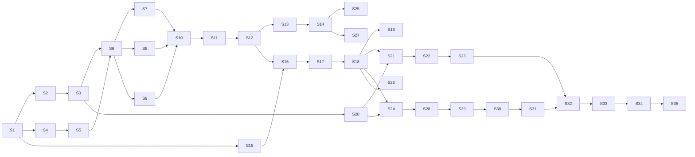

# 11 — Sequential Development Roadmap

**Revision 2 (2026-11-14):** this revision adds the integration architecture ([Integrations](../2-architecture/2-integrations.md)). The new or reshaped steps are 6, 8, 9, 10, 12, 14, 25, 26, and 27. Steps were renumbered. The old-to-new mapping is at the end.

35 steps in 7 milestones. Each step is independently testable and ends with a **step report** (`docs/progress/step-NN.md`) and a stop for your approval.

## Standard Definition of Done (applies to every step)
1. Only the approved scope is implemented. Deviations are raised before they are made.
2. Code is lint-clean (ruff/eslint), type-checked (mypy/tsc), and formatted.
3. The required tests are written and **all CI-runnable tests pass**. Any test that cannot run is reported, never hidden.
4. Docs are updated (setup, config, API, or architecture as relevant). `.env.example` is updated.
5. The step report lists: files changed, what was implemented, exact local commands, test output summary, known limitations.
6. No secrets are committed (gitleaks clean).

Each step below lists only its **additional** DoD items.

## Milestone overview and MoSCoW coverage

| # | Step | Milestone | MoSCoW features | Priority |
|---|---|---|---|---|
| 1 | Repository scaffold, tooling, CI skeleton | M1 Foundations | P9 | Must |
| 2 | Database foundation and migrations | M1 | (P2 base) | Must |
| 3 | Authentication, RBAC, API keys, audit log | M1 | P1, P2, P3, P21 | Must (+Should) |
| 4 | AVIRO demo app with fault injection | M2 Telemetry & Integrations | A1, A8, I8 | Must |
| 5 | Telemetry storage backends | M2 | A3, A4, A5 (storage side) | Must |
| 6 | **Integration model, ingest tokens, OTLP ingestion gateway** | M2 | I1, I2, I3, I4, A2 | Must |
| 7 | Telemetry query adapters and redaction | M2 | P4, (C1 base) | Must |
| 8 | **SENTINEL Agent: Linux hosts and container hosts (Podman/Docker)** | M2 | I5, I6, I7, A6, A7 (partial) | Must |
| 9 | **External health checks (prober)** | M2 | I9 | Must |
| 10 | Rule packs, signal, deployment, and webhook ingestion | M3 Detection | B1–B5, C2, I10, I11 | Must (+Should) |
| 11 | Log error grouping and fingerprinting | M3 | B6 | Must |
| 12 | Entity-aware correlation, severity, lifecycle, timeline | M3 | B7, B8, B9, I12 | Must |
| 13 | Frontend foundation: login, incidents, timeline | M3 | P7 (part) | Must |
| 14 | **Integrations UI: catalogue, setup wizard, verification, health, inventory** | M3 | I13, I14 | Must |
| 15 | Local LLM gateway and model benchmark | M4 AI Core | P5 | Must |
| 16 | Evaluation harness and scenario fixtures | M4 | P6 (+ detection metrics) | Must |
| 17 | Job queue and deterministic evidence collection | M4 | C1, C3, C4 | Must |
| 18 | RCA investigation graph with citation validation | M4 | C5, C6 | Must |
| 19 | Investigation UI, live progress, feedback | M4 | C7, C9, P7 | Must (+Should) |
| 20 | GitHub repository integration and mirror | M5 Code & Memory | D1, D2 | Must |
| 21 | Code investigation subgraph | M5 | D3, D4, D5, D7 | Must (+Should) |
| 22 | Incident memory: resolutions, embeddings, similarity | M5 | G1–G4 | Must (+Should) |
| 23 | Incident reports | M5 | H1, H2, H3 | Must (+Should) |
| 24 | Approval workflow and GitHub issue action | M6 Response, Repair & Extended Integrations | F1, F2 | Must |
| 25 | **Database, job check-in, and Node.js integrations** | M6 | I15, I16, I17 | Should |
| 26 | **Manual diagnostic upload investigations** | M6 | I18 | Should |
| 27 | **AWS account connector (CloudWatch, EC2 status, CloudTrail)** | M6 | I19, I20 | Should |
| 28 | Privileged runner: restart and rollback actions | M6 | F3, F4 | Should |
| 29 | Sandbox test execution | M6 | E1, E3 | Should |
| 30 | Code repair graph and patch review UI | M6 | E2, E4, E5 | Should |
| 31 | Draft pull request action | M6 | F5 | Should |
| 32 | Security hardening and prompt-injection suite | M7 Production | P4, security tests | Must |
| 33 | AWS infrastructure (OpenTofu), CPU inference and ingestion benchmarks | M7 | P8 (part) | Must |
| 34 | Continuous deployment and production deployment | M7 | P8 | Must |
| 35 | Operational readiness and published evaluation | M7 | P16, P17, P6 report | Must (+Should) |

**Must-only path to a credible v1.0:** steps 1–24 and 32–35. Steps 25–31 (Should) can be deferred independently of each other, except 29 → 30 → 31, which form a chain. Could Haves are in the post-v1 backlog.

---

## Milestone M1 — Foundations

### Step 1 — Repository scaffold, tooling, CI skeleton
- **Objective:** a clean, reproducible project skeleton that every later step builds on.
- **Plain language:** set up the folders, tools, and automated checks, plus a "hello" API that proves the pipeline works.
- **Features:** P9.
- **Implementation:** git init. `backend/` with uv and Python 3.12, FastAPI app factory, `/healthz`, pydantic-settings config, structlog JSON logging. `frontend/` Vite React TS hello page. Makefile. pre-commit (ruff, mypy, gitleaks, prettier). `deploy/compose/compose.yaml` (run with `podman compose`) with Postgres (pgvector image) and api. GitHub Actions `ci-backend`, `ci-frontend`, `security` (gitleaks only for now). README skeleton, LICENSE, `.env.example`.
- **Files/modules:** `backend/pyproject.toml`, `backend/src/sentinel/{__init__,config,cli}.py`, `backend/src/sentinel/api/app.py`, `backend/tests/unit/test_health.py`, `frontend/*`, `.github/workflows/*.yml`, `Makefile`, `deploy/compose/compose.yaml`.
- **DB changes:** none.
- **Dependencies:** tool installs: uv, Python 3.12, Node 24 LTS, **Podman** with `podman machine` and podman-compose (decision D7). Includes a short **Podman compatibility spike**: Compose subset, Testcontainers, multi-arch build.
- **Testing:** health endpoint test. Config loading test.
- **Acceptance criteria:** `make dev` starts the API and `curl localhost:8000/healthz` → 200. `make test` and `make lint` pass. Frontend builds.
- **Extra DoD:** CI workflows green on GitHub (if the repo is pushed).
- **Risks:** local toolchain mismatch (system Python 3.9.6, so uv-managed 3.12 is required).
- **Expected output / how you verify:** run the commands in the step report. Open the CI run.

### Step 2 — Database foundation and migrations
- **Objective:** an async SQLAlchemy and Alembic setup with core tables and test infrastructure.
- **Plain language:** create the database layer and a safe way to evolve it.
- **Implementation:** SQLAlchemy 2 async engine (asyncpg), session dependency, UUIDv7 helper, base model. Alembic env with `pgvector` and `pgcrypto`. Tables: `users`, `sessions`, `api_keys`, `audit_log`, `jobs` (schema only). DB roles script. `make db-docs`. Testcontainers fixture.
- **Files/modules:** `sentinel/db/{engine,base,models/*,repositories/*}.py`, `db/migrations/versions/0001_*.py`, `tests/db/conftest.py`, `scripts/db_roles.sql`.
- **DB changes:** initial schema.
- **Dependencies:** Step 1.
- **Testing:** upgrade, downgrade, upgrade cycle. CRUD. `audit_log` UPDATE/DELETE denied for the app role.
- **Acceptance criteria:** `make migrate` works on a fresh DB. DB tests pass in CI.
- **Extra DoD:** `docs/database.md` generated.
- **Risks:** async session lifecycle. Testcontainers with Podman (`DOCKER_HOST` set to the Podman socket, Ryuk disabled).
- **How you verify:** `make migrate && make test-db`. Inspect with `psql`.

### Step 3 — Authentication, RBAC, API keys, audit log
- **Objective:** secure access control before any feature endpoints exist.
- **Plain language:** users log in, roles limit what they can do, machines use keys, and important actions are recorded.
- **Features:** P1, P2, P3, P21.
- **Implementation:** Argon2id. Server-side sessions with cookie. CSRF double-submit. Permission enum and role map. `require(permission)` dependency. **Every router is registered with a permission declaration, and a test fails if one is missing.** Scoped API keys. Hash-chained audit writer plus `/audit/verify`. Login rate limiting. `sentinel create-admin` CLI. User admin and invite endpoints (no public sign-up, decision D11).
- **Files/modules:** `sentinel/auth/*`, `sentinel/security/audit.py`, routers `{auth,users,api_keys,audit}.py`.
- **Dependencies:** Step 2.
- **Testing:** route × role matrix, CSRF, lockout, no user enumeration, key scopes, audit tamper detection.
- **Acceptance criteria:** anonymous → 401, wrong role → 403. Security tests pass.
- **Extra DoD:** the RBAC docs table matches the code (generated check).
- **How you verify:** create an admin with the CLI, log in with `curl`, try a forbidden route.

## Milestone M2 — Telemetry & Integrations Platform

### Step 4 — AVIRO demo app with fault injection
- **Objective:** a realistic multi-service system to monitor, with reproducible faults. It is built as an **ordinary external application** that knows nothing about SENTINEL internals.
- **Plain language:** build the "patient" that SENTINEL will diagnose.
- **Features:** A1, A8, I8 (Python OTel instrumentation).
- **Implementation:** separate repo `aviro-shop` (decision D1). gateway, orders, payments, inventory (FastAPI), a Celery worker with Valkey, and Postgres. Standard OTel auto-instrumentation exporting to a configurable `OTEL_EXPORTER_OTLP_ENDPOINT`. `/healthz` and `/readyz`. Authenticated runtime fault flags (latency, error rate, dependency timeout, memory leak, **CPU hog, disk fill, process crash**). Code faults as real commits and tags (`scenario/S01-bad`, …). Locust load generator. Deploy script that tags images and emits a deployment event (wired in Step 10).
- **Files/modules (demo repo):** `services/*`, `worker/`, `loadgen/`, `scripts/deploy_scenario.sh`, `tests/`, `compose.yaml`.
- **Dependencies:** Step 1 conventions.
- **Testing:** unit tests per service. Each fault flag produces its intended symptom (automated smoke).
- **Acceptance criteria:** `podman compose up` gives healthy services. Every fault reproduces.
- **Risks:** time sink. Keep services to ~200–400 LOC each.
- **How you verify:** start it, run load, flip a fault flag, see the effect.

### Step 5 — Telemetry storage backends
- **Objective:** run Prometheus (OTLP receiver enabled), Alertmanager, Loki (OTLP), and Jaeger v2 as SENTINEL's telemetry stores.
- **Plain language:** set up the "filing cabinets" where all monitoring data will be kept.
- **Features:** storage side of A3, A4, A5.
- **Implementation:** `compose.observability.yaml` with pinned image digests, retention settings, memory limits. Prometheus `--web.enable-otlp-receiver` with a pinned name-translation strategy and RED recording rules. Loki OTLP endpoint. Jaeger with Badger storage. All on an internal network (not publicly reachable).
- **Files/modules:** `deploy/prometheus/*`, `deploy/loki/loki.yaml`, `deploy/jaeger/*`, `deploy/compose/compose.observability.yaml`.
- **Dependencies:** Step 4.
- **Testing:** integration test that pushes synthetic OTLP directly to each backend and queries it back.
- **Acceptance criteria:** all three accept OTLP and answer queries. Stack memory ≤ 2.5 GB.
- **Risks:** version-specific config drift. Pin everything.
- **How you verify:** run the provided `curl` and query commands.

### Step 6 — Integration model, ingest tokens, OTLP ingestion gateway
- **Objective:** one authenticated, normalising entry point for all pushed telemetry.
- **Plain language:** build the "front door" that every monitored system sends data through, which checks who it is and tidies the data into one standard shape.
- **Features:** I1 (common ingestion pipeline), I2 (integration registry and tokens), I3 (normalisation and enrichment), I4 (health and last-seen tracking), A2.
- **Implementation:** `integrations` and `ingest_tokens` tables and API (create, list, rotate, revoke). Caddy site `ingest.<host>` with `forward_auth` → `sentinel-api /internal/ingest-auth` (validates the token, returns `X-Sentinel-Integration-Id` and kind, enforces per-token rate limit, records last-seen per signal type, flushed every 30 s). Gateway OTel Collector: `otlp` receiver with `include_metadata`, `memory_limiter`, `attributes` from context (identity overwrite), `transform` (OTTL normalisation rules), `redaction` processor, cardinality guard, exporters to Prometheus, Loki, and Jaeger. Entity discovery job that reads resource attributes (from a `count`-connector summary metric) into the `entities` and `entity_relations` tables. **AVIRO is now onboarded through this gateway with its own integration token** (dogfooding).
- **Files/modules:** `sentinel/integrations/{models,service,tokens,health,entities}.py`, `sentinel/api/routers/{integrations,ingest_auth}.py`, `deploy/otel/gateway.yaml`, `deploy/caddy/Caddyfile`.
- **DB changes:** `integrations`, `ingest_tokens`, `integration_signal_status`, `entities`, `entity_relations`.
- **Dependencies:** Steps 3, 5.
- **Testing:** no token / revoked token → 401 at Caddy. Client-supplied `sentinel.integration.id` is overwritten (spoofing test). Normalisation rules unit-tested with OTTL fixtures (collector run in a test container). Rate limit returns 429. Last-seen updates. Entity discovery from sample resources.
- **Acceptance criteria:** AVIRO telemetry arrives only through the gateway and is queryable with correct `sentinel.integration.id` and normalised attributes. Its integration shows `healthy`, then `stale` within 5 min of stopping it.
- **Risks:** forward_auth per-request overhead (measured; fine at MVP scale, with a custom Collector auth extension as the fallback). OTTL learning curve.
- **How you verify:** create an integration through the API, send telemetry with and without a token, and watch its status.

### Step 7 — Telemetry query adapters and redaction
- **Objective:** typed, safe, size-capped access to stored telemetry, plus secret redaction.
- **Plain language:** teach SENTINEL to read the stored data safely.
- **Features:** P4, the base of C1.
- **Implementation:** `PrometheusClient`, `LokiClient`, `JaegerClient` with template query builders, timeouts, caps, and integration and entity filters. `FixtureTelemetryAdapter` (record and replay). Redaction engine (regex, entropy, allowlist). ANSI and control-character stripping.
- **Files/modules:** `sentinel/telemetry/*`, `sentinel/security/redaction.py`.
- **Dependencies:** Step 6.
- **Testing:** recorded-response unit tests. Integration against live backends. Redaction corpus (100% of seeded secrets removed). Property tests.
- **Acceptance criteria:** adapters and the redaction corpus pass.
- **How you verify:** `sentinel telemetry query …` debug CLI against the running demo.

### Step 8 — SENTINEL Agent: Linux hosts and container hosts (Podman/Docker)
- **Objective:** let a user monitor any Linux machine (EC2, other cloud VM, on-prem, local VM) and its Podman or Docker containers with one install.
- **Plain language:** a one-command installer that sets up the standard OpenTelemetry Collector to send machine and container data to SENTINEL.
- **Features:** I5 (agent packaging and installer), I6 (host, process, and log collection), I7 (Podman and Docker container collection), A6 and A7 partial (local scrape of the demo's Celery and Postgres exporters).
- **Implementation:** agent config templates (hostmetrics incl. filesystem, process for **watched processes only**, journald, filelog with multiline recombine, `docker_stats` against the **Podman API socket (`podman.socket`) or Docker socket** through a **GET-only socket proxy**, optional prometheus scrape, a local OTLP receiver for apps). `install.sh` (detects distro and arch, downloads a **pinned** `otelcol-contrib` package, verifies checksum and cosign signature, creates the `sentinel-agent` user and groups, writes config and a `0600` env file, installs the systemd unit, writes a verification marker to the journal). Uninstall script. Agent container image variant (`/hostfs` mounts). Config hash reported as a resource attribute. Agent self-telemetry enabled. The integration API serves the rendered config per integration.
- **Files/modules:** `agent/{templates/*.yaml.j2,install.sh,uninstall.sh,Containerfile,README.md}`, `sentinel/integrations/agent_config.py`, `tests/agent/`.
- **DB changes:** none (uses `integrations.config`).
- **Dependencies:** Step 6.
- **Testing:** config rendering unit tests. Collector `validate` on every rendered config in CI. **Install test in a disposable Ubuntu 24.04 container with systemd and in a Lima VM** (local, with Ollama stopped because of RAM). Verification marker received end to end. Uninstall leaves no residue. Footprint measured (RSS, CPU) under AVIRO load. socket proxy denies POST.
- **Acceptance criteria:** on a fresh Ubuntu VM, the installer brings the integration to `healthy` within 2 min. Host metrics, journal, and container metrics and logs are queryable and attributed to the right entities. Footprint numbers published.
- **Risks:** distro variance (support Ubuntu/Debian and Amazon Linux 2023 only in MVP). Collector component maturity (journald). Permissions for log files.
- **How you verify:** spin up a Lima VM, run the installer command shown by the API, and watch the host appear.

### Step 9 — External health checks (prober)
- **Objective:** monitor systems from the outside with no install.
- **Plain language:** SENTINEL regularly visits your public URLs and checks they answer correctly and quickly, and that certificates aren't about to expire.
- **Features:** I9.
- **Implementation:** `sentinel-prober` process in its own container on an egress-only network. HTTP(S), TCP, and TLS expiry checks. Status and body assertions. **SSRF guard** (resolve, reject private, loopback, link-local, metadata, and CGNAT ranges for IPv4 and IPv6, pin the vetted IP, re-validate redirects). Jittered scheduling. Results emitted as OTLP metrics (`probe_success`, `probe_duration`, `tls_cert_expiry`) through the gateway with its own integration identity. Probe-state-change `SentinelEvent`s.
- **Files/modules:** `sentinel/prober/{checks,ssrf_guard,scheduler}.py`, router `checks.py`.
- **DB changes:** `health_checks`.
- **Dependencies:** Step 6.
- **Testing:** SSRF test suite (`127.0.0.1`, `169.254.169.254`, `[::1]`, `10.x`, decimal or octal IP forms, DNS rebinding with a test resolver, redirect to private). Check behaviour against local test servers (slow, 500, bad cert).
- **Acceptance criteria:** the SSRF suite passes 100%. A AVIRO endpoint going down is visible in metrics within 2 intervals.
- **Risks:** being abused for scanning. Mitigated with caps, minimum interval, and audit.
- **How you verify:** add a check for the demo gateway, stop it, and watch the probe fail.

## Milestone M3 — Detection

### Step 10 — Rule packs, signal, deployment, and webhook ingestion
- **Objective:** turn telemetry and external events into stored signals and change events.
- **Features:** B1–B5, C2, I10 (deployment and GitHub webhooks), I11 (rule packs per entity type).
- **Implementation:** Prometheus rule packs for host, container, service, database, endpoint, and integration, written generically by label ([Integrations §3.4](../2-architecture/2-integrations.md#34-detection-rule-packs-per-entity-type)). Alertmanager → `POST /ingest/alertmanager` (idempotent). `SentinelEvent` store. Generic `POST /ingest/deployments`. GitHub webhook (HMAC, `deployment_status`, `push`, `workflow_run`) → events. Stale-integration → `telemetry_gap` signal with disambiguation (probe or cloud state).
- **Files/modules:** `deploy/prometheus/rules/packs/*.yml`, `sentinel/ingestion/*`, `sentinel/events/*`, routers.
- **DB changes:** `signals`, `events`, `deployments` (deployments as a typed view or table fed by events).
- **Dependencies:** Steps 7, 8, 9.
- **Testing:** `promtool test rules` for every rule. Webhook fixtures, signatures, idempotency. Gap disambiguation table tests.
- **Acceptance criteria:** S01 → signal in ≤ 3 min. Host disk-fill fault → host signal. Agent stopped → `telemetry_gap`. 30 min of normal load → no signals.
- **How you verify:** trigger faults and list signals and events through the API.

### Step 11 — Log error grouping and fingerprinting
- **Features:** B6.
- **Implementation:** scheduler loop with a watermark. LogQL for ERROR and exception logs per entity (service *or* host/unit). Traceback parser. Message normaliser. Fingerprint = hash(type, normalised message, top in-app frame). New and spike signals.
- **Files/modules:** `sentinel/detection/{fingerprint,traceback,error_groups,poller}.py`.
- **DB changes:** `error_groups`, `poll_watermarks`.
- **Dependencies:** Step 10.
- **Testing:** Hypothesis property tests. Traceback corpus. Poller restart safety with fixtures.
- **Acceptance criteria:** S01 → exactly one new error group with the correct top frame.
- **How you verify:** trigger S01 and list error groups.

### Step 12 — Entity-aware correlation, severity, lifecycle, timeline
- **Features:** B7, B8, B9, I12 (topology-aware correlation).
- **Implementation:** correlator: attach a signal to an open incident when the entities are the same **or related** (runs_on, uses, fronts), traces are shared, or it falls within the time window. Otherwise create a new incident. Severity rules (consider entity criticality). Nearest deployment and change event linked. State machine. Timeline. Incident API. Investigation job enqueued (handler stub until Step 17).
- **Files/modules:** `sentinel/detection/correlator.py`, `sentinel/incidents/*`, router.
- **DB changes:** `incidents`, `incident_entities`, `incident_signals`, `incident_events`.
- **Dependencies:** Step 11.
- **Testing:** correlation tables, including the topology case (host disk full + service 5xx on that host → 1 incident; unrelated host → separate). State machine. Severity.
- **Acceptance criteria:** S01 → 1 incident with linked deployment. Disk-fill on the AVIRO host plus resulting errors → 1 incident with both entities. S08 → 0 incidents.
- **How you verify:** run the scenarios and list incidents.

### Step 13 — Frontend foundation: login, incidents, timeline
- **Features:** P7 (part).
- **Implementation:** routing, auth context, generated API client, layout, incidents list and detail with entities, signals, and timeline, role-aware controls.
- **Dependencies:** Steps 3, 12.
- **Testing:** component tests, XSS-rendering test, Playwright login → incident detail.
- **Acceptance criteria:** a viewer can't change status. The E2E test passes.
- **How you verify:** log in, trigger S01, watch the incident appear.

### Step 14 — Integrations UI: catalogue, setup wizard, verification, health, inventory
- **Objective:** the user-facing onboarding experience described in [Integrations §5](../2-architecture/2-integrations.md#5-user-setup-experience).
- **Plain language:** an "Add integration" screen that walks you through connecting a server, app, URL, or repo, shows a live checklist as data arrives, and then lists everything being monitored.
- **Features:** I13 (catalogue, wizard, verification checklist), I14 (inventory and integration health dashboard).
- **Implementation:** catalogue page (MVP tiles: Linux host, Container host, Python app, HTTP check, Deployment webhook, GitHub (placeholder until Step 20), Alertmanager). Per-kind wizards (configure → token shown once → tailored instructions → live checklist polling `/integrations/{id}/status`). Token rotate and revoke. Inventory page (entities, relations, last seen). Health tiles and stale warnings.
- **Files/modules:** `frontend/src/pages/integrations/*`, `components/integrations/*`, backend status endpoint enrichments.
- **Dependencies:** Steps 8, 9, 10, 13.
- **Testing:** component tests. E2E: create a Linux-host integration → the (containerised) agent installs → checklist ticks → host visible in inventory.
- **Acceptance criteria:** a new user can onboard a Linux VM and an HTTP check using only the UI instructions (dry run with you as the tester).
- **How you verify:** follow the wizard yourself on a Lima VM.

**→ Checkpoint: multi-source detection works with no AI at all.**

## Milestone M4 — AI Core

### Step 15 — Local LLM gateway and model benchmark
- **Features:** P5.
- **Implementation:** Ollama client (`/api/chat` with JSON-schema `format`, `/api/embed`), timeouts, retries, thinking toggle, `num_ctx`, keep_alive. Structured-output helper. `llm_calls` logging plus OTel spans. FakeLLM and ReplayLLM. Benchmark script (tokens/s, TTFT, schema conformance, memory) for the candidate models on the M4.
- **Files/modules:** `sentinel/llm/*`, `scripts/bench_models.py`, `docs/benchmarks/models-m4.md`.
- **DB changes:** `llm_calls`, `llm_call_payloads`.
- **Dependencies:** Ollama installed natively.
- **Testing:** mock-server unit tests. `requires_ollama` integration test (skipped in CI).
- **Acceptance criteria:** a measured benchmark report. Default model recommendation for approval (D2).
- **How you verify:** `make bench-models`.

### Step 16 — Evaluation harness and scenario fixtures
- **Features:** P6 plus measured detection metrics.
- **Implementation:** scenario schema. Orchestrator (deploy tag or fault flag, load, wait, record fixtures, collect incidents). Detection metrics. Results writer. **Scenario suite S01–S16**, now including host and integration scenarios ([Testing](../3-quality/1-testing-and-evaluation.md#2-evaluation-scenario-suite)).
- **Files/modules:** `evals/scenarios/*`, `sentinel/evals/*`, `evals/README.md`.
- **Dependencies:** Steps 4–14, 15.
- **Testing:** metric functions tested on synthetic ground truth.
- **Acceptance criteria:** a committed results folder with real detection metrics.
- **How you verify:** `make eval-detection` and read the report.

### Step 17 — Job queue and deterministic evidence collection
- **Features:** C1, C3, C4.
- **Implementation:** Postgres job queue (SKIP LOCKED, heartbeat, retries, dead-letter, NOTIFY). Worker. Evidence with `E-n` IDs. **Entity-aware collectors:** service (logs, error groups, RED, traces), host (CPU, memory, disk, process series, journal excerpts), container (restarts, OOM), endpoint (probe history), integration (gap analysis), change events (deployments and others in the window). Before/after deploy comparison. Affected-entity analysis (trace propagation plus topology).
- **Files/modules:** `sentinel/jobs/*`, `sentinel/evidence/{models,collectors/*,comparison,digest}.py`.
- **DB changes:** `evidence`, `investigations`, `investigation_steps`.
- **Dependencies:** Steps 12, 16.
- **Testing:** queue concurrency and crash recovery. Collector fixture tests. Comparison statistics.
- **Acceptance criteria:** required evidence kinds present for every scenario fixture (collector coverage measured).
- **How you verify:** `GET /incidents/{id}/evidence` after a scenario.

### Step 18 — RCA investigation graph with citation validation
- **Features:** C5, C6.
- **Implementation:** LangGraph investigation graph, Postgres checkpointer, RCA Analyst prompt v1, digest builder, validator, follow-up requests (allowlisted templates, incl. on-demand connector queries when available), confidence scoring, rule-based action proposals, budgets. RCA metrics in the harness.
- **Files/modules:** `sentinel/investigation/*`.
- **DB changes:** `hypotheses`, `hypothesis_evidence`.
- **Dependencies:** Steps 15, 17.
- **Testing:** FakeLLM workflow tests (citations, degraded, loop limits, timeout, resume). First RCA baseline, N=5.
- **Acceptance criteria:** 100% of persisted hypotheses have valid citations. The baseline is committed whatever it is.
- **How you verify:** trigger S01 and read the hypotheses and the evaluation report.

### Step 19 — Investigation UI, live progress, feedback
- **Features:** C7, C9, P7.
- **Implementation:** SSE. Progress panel. Evidence browser (logs, metric charts with change markers, trace waterfall-lite, host panels). Hypothesis cards with evidence chips. Feedback. Re-investigate.
- **Dependencies:** Steps 13, 18.
- **Testing:** SSE reconnect. E2E with FakeLLM.
- **Acceptance criteria:** every hypothesis links to evidence. Feedback is on the timeline.
- **How you verify:** watch an investigation live.

**→ Release v0.1 "Detect & Explain"**

## Milestone M5 — Code awareness and memory

### Step 20 — GitHub repository integration and mirror
- **Features:** D1, D2. Also completes the GitHub tile in the integrations catalogue.
- **Implementation:** read-only fine-grained PAT (encrypted). Repository integration (catalogue wizard). Bare mirror, hooks disabled, symlink-safe. Sync on schedule or webhook. Commit-window listing. Service ↔ repository entity relation.
- **DB changes:** `repositories`, `credentials`.
- **Dependencies:** Steps 3, 10, 14.
- **Testing:** respx GitHub. Local bare-repo fixtures. Token never logged.
- **Acceptance criteria:** the S01 deploy window lists the culprit commit.
- **How you verify:** connect the demo repo through the wizard.

### Step 21 — Code investigation subgraph
- **Features:** D3, D4, D5, D7.
- **Implementation:** traceback → source at the deployed SHA, excerpts, suspicion scoring, path-confined ripgrep, Code Investigator prompt and bounded loop, code findings.
- **DB changes:** `code_findings`.
- **Dependencies:** Steps 18, 20.
- **Testing:** traversal and symlink tests. Scoring. FakeLLM subgraph. Evaluation: culprit-commit top-1.
- **Acceptance criteria:** metrics recorded vs the provisional 80% target.
- **How you verify:** the S01 incident shows a diff and code excerpt as evidence.

### Step 22 — Incident memory: resolutions, embeddings, similarity
- **Features:** G1–G4.
- **Implementation:** resolution capture. Memory documents (incl. entity types and fingerprints). nomic-embed-text embeddings. HNSW. Hybrid search. Similar incidents as evidence.
- **DB changes:** `resolutions`, `incident_memory`.
- **Dependencies:** Steps 15, 18.
- **Testing:** pgvector tests. Seeded duplicate retrieval. Evaluation scenario S11.
- **Acceptance criteria:** retrieval@3 measured and reported.
- **How you verify:** resolve S01, run S11, see "similar incident" evidence.

### Step 23 — Incident reports
- **Features:** H1, H2, H3.
- **Implementation:** deterministic facts, Report Writer call, citation validation, Markdown template, versioning, download, UI.
- **DB changes:** `reports`.
- **Dependencies:** Steps 18, 22.
- **Testing:** snapshot tests. Factual consistency checker. No-LLM fallback.
- **Acceptance criteria:** all sections present. Consistency check passes (measured).
- **How you verify:** download a report for S01.

## Milestone M6 — Response, repair, and extended integrations

### Step 24 — Approval workflow and GitHub issue action
- **Features:** F1, F2.
- **Implementation:** action catalog, policy, request and approval state machine, separation of duties, expiry, executor with TOCTOU checks and idempotency, kill switch, `create_github_issue`, approval queue UI, import-linter contract.
- **DB changes:** `action_requests`, `approvals`, `action_executions`.
- **Dependencies:** Steps 3, 18, 20.
- **Testing:** security tests (unapproved, expired, or self-approved cannot execute). Mocked GitHub. E2E.
- **Acceptance criteria:** an issue is created only after approval.
- **How you verify:** approve in the UI and see the issue on GitHub.

**→ Release v0.2 "Code-aware"**

### Step 25 — Database, job check-in, and Node.js integrations *(Should)*
- **Features:** I15 (PostgreSQL), I16 (job and cron check-ins), I17 (Node.js instrumentation).
- **Implementation:** PostgreSQL catalogue tile, agent config fragment (`postgresql` receiver, `pg_monitor` SQL helper, optional slow-query filelog), DB rule pack enabled. Check-in monitors (cron expression, grace period), `POST /ingest/checkins/{token}` (start, ok, fail, duration), missed-run evaluation in the scheduler → signals. Node.js setup guide plus a small Node service added to AVIRO (e.g. `notifications`) to prove polyglot traces.
- **DB changes:** `checkin_monitors`, `checkins`.
- **Dependencies:** Step 14.
- **Testing:** check-in schedule evaluation with freezegun (on-time, late, missed, failed, DST edges). DB receiver integration test. Cross-language trace test.
- **Acceptance criteria:** a missed cron run → signal within the grace period. Pool exhaustion visible in DB metrics. A Node span appears in AVIRO traces.
- **How you verify:** stop the demo cron and watch the "missed" signal.

### Step 26 — Manual diagnostic upload investigations *(Should)*
- **Features:** I18.
- **Implementation:** upload endpoint (50 MB cap, decompression-ratio cap, archive traversal guard). Parsers (plain text, JSON lines, journalctl export, docker logs, Python tracebacks). Redaction. Evidence bundle storage. "Manual investigation" incidents or attaching uploads to existing incidents. Investigation graph accepts bundle evidence. Retention job.
- **DB changes:** `uploads`, `evidence_bundles`.
- **Dependencies:** Step 18.
- **Testing:** zip bomb, oversize, binary-file rejection, traversal, parser corpus, redaction.
- **Acceptance criteria:** uploading a recorded S01 log set produces cited hypotheses with no live integration.
- **How you verify:** upload the provided sample bundle.

### Step 27 — AWS account connector *(Should)*
- **Features:** I19 (connector framework), I20 (AWS: EC2 inventory and status checks, CloudWatch key metrics, CloudTrail change events).
- **Implementation:** `Connector` interface ([Integrations §3.6](../2-architecture/2-integrations.md#36-connector-interface-one-plugin-shape-for-all-pull-integrations)). CloudFormation template for a read-only role with ExternalId. STS AssumeRole from the SENTINEL instance role. Low-frequency poll → OTLP plus events. `query_for_investigation` for on-demand detail. EC2 entities linked to agent hosts via `host.id` or `cloud.resource_id`. Cost estimate shown in the wizard.
- **DB changes:** `connector_state`.
- **Dependencies:** Step 14 (UI), Step 17 (evidence).
- **Testing:** moto-based unit tests. Real-account integration test (manual, documented). The gap disambiguation uses EC2 status.
- **Acceptance criteria:** connecting a real AWS account lists instances. Stopping an instance produces a CloudTrail change event and a correct `telemetry_gap` interpretation.
- **Risks:** API costs and throttling (rate limits, on-demand detail).
- **How you verify:** connect your AWS account with the template and stop the demo instance.

### Step 28 — Privileged runner: restart and rollback actions *(Should)*
- **Features:** F3, F4.
- **Implementation:** `runner` service with HMAC, nonce, and timestamp, its own allowlist, Podman API (podman-py) `restart` and `rollback` for **SENTINEL-managed demo containers only** (remote hosts are not actionable, see [Integrations §6](../2-architecture/2-integrations.md#6-security-model-per-method)). Catalog entries. Rollback emits a deployment event.
- **Dependencies:** Step 24.
- **Testing:** unsigned, replayed, or non-allowlisted requests rejected. Real rootless Podman. S01 rollback E2E.
- **Acceptance criteria:** rollback resolves S01.
- **How you verify:** approve a rollback and watch the 5xx rate drop.

### Step 29 — Sandbox test execution *(Should)*
- **Features:** E1, E3.
- **Implementation:** sandbox image. Runner sandbox API. Hardened container. Output caps and redaction. pytest report parsing. `.sentinel.yml` profiles.
- **Dependencies:** Step 28.
- **Testing:** the sandbox security suite.
- **Acceptance criteria:** the suite passes on Linux CI and macOS.
- **How you verify:** `make sandbox-selftest`.

### Step 30 — Code repair graph and patch review UI *(Should)*
- **Features:** E2, E4, E5.
- **Implementation:** repair graph (≤ 3 attempts), Patch Engineer prompt, path and size allowlists, attempts persisted, SSE, diff UI.
- **DB changes:** `patches`, `patch_attempts`.
- **Dependencies:** Steps 21, 29.
- **Testing:** FakeLLM graph tests. Evaluation apply and pass rates.
- **Acceptance criteria:** metrics recorded. The diff and tests are shown.
- **How you verify:** "Propose patch" on S01.

### Step 31 — Draft pull request action *(Should)*
- **Features:** F5.
- **Implementation:** `open_draft_pr` action. `sentinel/` branch prefix. Draft only. Linked to the resolution.
- **Dependencies:** Steps 24, 30.
- **Testing:** mocked GitHub. Draft-flag assertion.
- **Acceptance criteria:** a draft PR exists after approval.
- **How you verify:** see the PR on GitHub.

**→ Release v0.3 "Repair & Integrations+"**

## Milestone M7 — Production

### Step 32 — Security hardening and prompt-injection suite
- **Implementation:** suspicious-content detector, security headers and CSP, full scanner workflow, licence scanning, threat-model review (incl. the integration threats in [Security](../2-architecture/6-security.md)), injection fixtures (logs **from external agents**, code comments, upload files), fixes.
- **Acceptance criteria:** S09 injected-action count = 0. All security tests green, including the ingestion spoofing, SSRF, and upload suites. Scanner findings fixed or justified.
- **How you verify:** `make test-security` plus the S09 report.

### Step 33 — AWS infrastructure (OpenTofu), CPU inference and ingestion benchmarks
- **Implementation:** OpenTofu modules (network, compute, storage, IAM incl. GitHub OIDC and connector AssumeRole permission, SSM, budgets). `ingest.<domain>` DNS. Bootstrap. First deploy. **Benchmarks:** small models on CPU, plus an **ingestion load test** (simulated N agents and log volume) to establish the published capacity. Optional second t4g.small "external monitored host" running AVIRO plus the agent (decision D12).
- **Testing:** `tofu validate`, tflint, checkov. Post-provision checks (no SSH, IMDSv2, private bucket).
- **Acceptance criteria:** HTTPS UI and ingest endpoint up. Benchmark and capacity report committed. Cost tracked after 7 days.
- **How you verify:** open the URL, onboard the second host through the wizard, check the Billing console.

### Step 34 — Continuous deployment and production deployment
- **Implementation:** `deploy.yml` (OIDC, arm64 build, SSM deploy, migrations, smoke tests incl. an ingest smoke test, rollback by SHA). Agent installer and config published at a versioned URL. Showcase incident import (if D3 option B).
- **Acceptance criteria:** commit + approval → deployed. Rollback drill done.
- **How you verify:** run the workflow and check `/api/v1/meta`.

### Step 35 — Operational readiness and published evaluation
- **Features:** P16, P17, final P6 report.
- **Implementation:** self-instrumentation (SENTINEL is onboarded through its own gateway), self-alerts, backups with a **tested restore**, failure and recovery suite, final evaluation incl. the held-out set, README results, demo video, docs pass.
- **Acceptance criteria:** restore drill succeeds. Honest held-out results published.
- **How you verify:** read the final report and run the restore drill.

**→ Release v1.0**

---

## Post-v1 backlog (Could Have)
A9 Grafana dashboards · B10 statistical anomaly detection · B11 notifications · C8 follow-up Q&A · D6 semantic code search · E6 regression-test generation · F6 retry failed jobs · F7 purge DLQ · G5 postmortem import · P10 OIDC login · P14 read-only MCP server · I21 Kubernetes (Helm values, tested on kind) · I22 MySQL · I23 Podman · I24 datasource mode (existing Prometheus/Loki) · I25 generic third-party alert webhooks · I26 OpAMP remote agent management · I27 private-network probe runner · I28 AWS API actions (reboot, SSM restart) with approval.

Also deferred: **I29 slim custom Collector build (OCB)**. It is a *Should* item, scheduled after v1 unless time allows. The MVP uses the official pinned `otelcol-contrib` release.

## Old → new step mapping (revision 1 → revision 2)
1→1, 2→2, 3→3, 4→4, 5→5 (storage only), new 6, 6→7, new 8, new 9, 7→10, 8→11, 9→12, 10→13, new 14, 11→15, 12→16, 13→17, 14→18, 15→19, 16→20, 17→21, 18→22, 19→23, 20→24, new 25, new 26, new 27, 21→28, 22→29, 23→30, 24→31, 25→32, 26→33, 27→34, 28→35.
