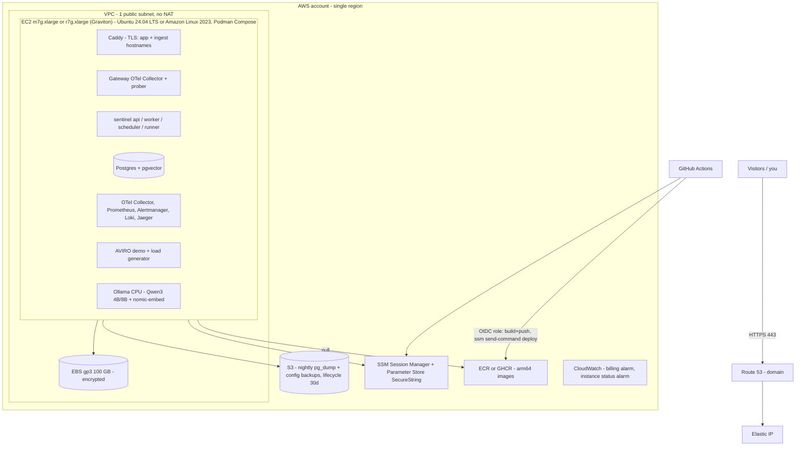

# 09 — AWS Deployment Plan and Cost Estimate

## 1. Approach

The portfolio MVP runs on **a single Graviton (ARM64) EC2 instance running rootless Podman with `podman compose`** ([ADR-0009](../adr/0009-single-ec2-compose.md)). It hosts the whole stack: SENTINEL, Postgres, the observability stack, the AVIRO demo app, and **Ollama on CPU with a small model**.

Why not ECS, EKS, or RDS for the MVP? An ALB alone costs about $16–25/month, a NAT gateway about $33+/month, and RDS about $25+/month. Fargate cannot host an 8–16 GB LLM process cheaply. None of these improve the demo. They are listed as **optional** upgrades below.

### The CPU-inference trade-off (decision needed)
The M4 runs Qwen3 14B with Metal acceleration. A small CPU instance cannot run 14B at a usable speed. Options:

| Option | Description | Pros | Cons |
|---|---|---|---|
| **A (recommended)** | Live inference on EC2 CPU with a **small model (Qwen3 4B, or 8B if the benchmark allows)**. Investigations are asynchronous | Truly live, end-to-end on AWS. Honest demo | Lower RCA quality than 14B. Minutes per investigation. Must be measured (Step 33) |
| B | A + **"showcase incidents"** precomputed on the M4 with 14B and imported into the AWS database, clearly labelled with model and hardware | Visitors see best-quality output instantly | Showcase data is not live (labelled as such) |
| C | Larger memory-optimised instance for 14B on CPU | Best live quality | Expensive (32 GB+ instance), still slow |

**Recommendation: A + B.** Live demo with the small model, plus labelled showcase incidents from the M4 run.

## 2. Infrastructure diagram

## 3. AWS services

| Service | Essential? | Purpose |
|---|---|---|
| EC2 (Graviton, on-demand) | ✅ | Hosts everything |
| EBS gp3 | ✅ | Root and data volume (Postgres, Loki, Prometheus, Jaeger, models). Encrypted |
| Elastic IP (public IPv4) | ✅ | Stable address. AWS charges for all public IPv4 addresses |
| Route 53 hosted zone | ✅ (if using a custom domain) | DNS. Domain registration is extra (about $10–15/yr for .com) |
| S3 | ✅ | Backups |
| IAM + OIDC provider | ✅ | Instance role, GitHub Actions deploy role. No static keys |
| SSM (Session Manager, Run Command, Parameter Store standard) | ✅ | Admin access without SSH. Deploy commands. Secrets |
| CloudWatch (basic metrics, 2–3 alarms) + AWS Budgets | ✅ | Instance health and **cost alarm** |
| ECR | Optional (GHCR is free for public images) | Image registry |
| AWS Backup / EBS snapshots | Optional | Volume-level backups |
| RDS PostgreSQL (supports pgvector) | Optional | Managed DB if the project grows |
| ALB + ACM | Optional | Only if moving to multiple instances or ECS |
| Second instance (inference node) | Optional | Separate Ollama from the app for bigger models |

## 4. Sizing

| Workload | Approx. memory |
|---|---|
| Ollama + Qwen3 4B Q4 (+8k ctx) / 8B Q4 | ~4 GB / ~7 GB |
| nomic-embed-text | ~0.5 GB |
| Postgres | 1 GB |
| Loki, Prometheus, Jaeger, Collector, Alertmanager | 1.5–2.5 GB |
| SENTINEL processes | 1–1.5 GB |
| AVIRO (5 services + worker + DB + Valkey) + load generator | 1.5–2 GB |
| OS and headroom | 1.5 GB |
| **Total** | **~11–12 GB (4B) / ~14–16 GB (8B)** |

- **m7g.xlarge** (4 vCPU, 16 GB): fits the 4B model comfortably. 8B is tight.
- **r7g.xlarge** (4 vCPU, 32 GB): fits 8B comfortably.
- Avoid burstable **t4g** instances for inference. Sustained CPU use burns credits or incurs "unlimited" surcharges.
- CPU throughput is **measured in Step 33** (tokens/s and investigation time). It is not assumed.

## 5. Monthly cost estimates (USD)

Prices are **approximate on-demand list prices for us-east-1**, based on the assistant's knowledge. **Verify with the AWS Pricing Calculator before provisioning.** European regions (for example eu-west-2 London) are typically about 10–20% higher. No free tier is assumed. 1 month = 730 h.

| Item | Unit price (approx.) | Tier 1: "Scheduled demo" (~120 h/mo) | Tier 2: "Always-on, 4B" | Tier 3: "Always-on, 8B" |
|---|---|---|---|---|
| EC2 m7g.xlarge | ~$0.163/h | ~$20 | ~$119 | — |
| EC2 r7g.xlarge | ~$0.214/h | — | — | ~$156 |
| EBS gp3 100 GB | ~$0.08/GB-mo | $8 | $8 | $8 |
| Public IPv4 (Elastic IP) | ~$0.005/h | $3.65 (charged even when stopped) | $3.65 | $3.65 |
| S3 backups (~10 GB) | ~$0.023/GB-mo | <$1 | <$1 | <$1 |
| Route 53 hosted zone | $0.50/zone | $0.50 | $0.50 | $0.50 |
| Data transfer out (~10–50 GB) | ~$0.09/GB beyond allowance | $0–5 | $0–5 | $0–5 |
| CloudWatch alarms / logs (minimal) | — | ~$1–3 | ~$1–3 | ~$1–3 |
| SSM Parameter Store (standard) | no charge for standard params | $0 | $0 | $0 |
| ECR (if used, ~5 GB) | ~$0.10/GB-mo | ~$0.50 | ~$0.50 | ~$0.50 |
| **Estimated total** | | **~$35–45** | **~$135–145** | **~$170–180** |

**Optional add-ons:** RDS db.t4g.small + 20 GB (~$27–35), ALB (~$18–25), a 1-year Compute Savings Plan (about 25–35% lower EC2 cost), a separate inference node (+$60–160), and domain registration (~$1/mo amortised).

**Main cost drivers:** (1) EC2 instance hours, which make up about 85% of the total; (2) EBS size; (3) public IPv4; (4) egress if the demo gets popular.

**Cost controls:** an AWS Budgets alert at $50/$100/$150, an EventBridge-scheduled start/stop for Tier 1, Loki and Prometheus retention caps, an S3 lifecycle rule (30 days), no NAT gateway, and no load balancer.

## 5a. Integration-related costs (revision 2)

| Item | Estimate | Notes |
|---|---|---|
| Extra EBS for ingested data from external hosts | +50 GB ≈ **+$4/mo** | Logs dominate. Retention caps apply |
| Optional second instance "external monitored host" (t4g.small, 8 GB gp3, public IPv4) | **~$17/mo** always-on, **~$3–5/mo** scheduled | Runs AVIRO + agent and proves cross-machine monitoring (decision D12) |
| Ingest endpoint | $0 extra | Same Caddy and instance. Separate hostname `ingest.<domain>` |
| Ingress traffic from agents | $0 | AWS doesn't charge for inbound data transfer |
| **Paid by the monitored side** | Egress ≈ $0.09/GB from the user's cloud (gzip OTLP ~5–10× smaller than raw logs). CloudWatch GetMetricData ≈ $0.01 per 1,000 metrics (verify) | Shown in the setup wizard. Connectors poll minimally and fetch detail on demand ([Integrations §7](../2-architecture/2-integrations.md#7-costs)) |

Capacity on the always-on m7g.xlarge (target, **to be measured** in Step 33): about 10 hosts, 20 services, 50 probes, ≤ 3 GB logs/day while also running inference. Beyond that, move the telemetry stores or inference to a second instance.

## 6. Storage and bandwidth
- EBS 100 GB covers: models (~5 GB), container images (~10 GB), Postgres (<5 GB), Loki (7 d, ~5–10 GB with the demo load), Prometheus (15 d, ~2–5 GB), Jaeger Badger (7 d, ~5 GB), and repo mirrors (<1 GB), with headroom.
- The demo load generator is throttled (about 5–20 req/s) to keep telemetry volume, and therefore disk and CPU use, predictable.
- Bandwidth is dominated by UI assets (small) and image pulls (inbound, free).

## 7. Deployment approach
1. **IaC:** OpenTofu (MPL-2.0) in `deploy/infra/` defines the VPC, subnet, IGW, security group, EC2 with an instance profile, EBS, EIP, S3 bucket (versioned, encrypted, public access blocked), IAM roles (instance, GitHub OIDC deploy), SSM parameters (placeholders), budgets, and alarms. Remote state is in S3 with native lockfiles (OpenTofu ≥ 1.10), or a DynamoDB lock table.
2. **Bootstrap:** EC2 user-data installs Podman and podman-compose (Ubuntu 24.04 LTS is the default AMI because Podman is in its standard repositories. Amazon Linux 2023 is the alternative once its Podman packaging is verified), enables lingering for the rootless service user, enables automatic security updates, enables `dnf-automatic`, requires IMDSv2, and pulls models with Ollama.
3. **Build:** GitHub Actions builds **arm64** images with `podman build`, tags them with the git SHA, and pushes to GHCR (public) or ECR.
4. **Deploy:** a `workflow_dispatch` (manual approval through a GitHub Environment) assumes an AWS role through OIDC, runs `aws ssm send-command` to execute `deploy.sh <sha>`, which fetches secrets from Parameter Store, runs `docker compose pull && alembic upgrade && podman compose up -d`, and then runs smoke tests. Rollback means redeploying the previous SHA.
5. **Backups:** a nightly `pg_dump` → S3 (systemd timer). The restore is tested in Step 35.

## 8. Security requirements (AWS)
IMDSv2 only (hop limit 1), SG inbound 80/443 only, no SSH key pair, SSM for access, EBS and S3 encryption, S3 Block Public Access, least-privilege IAM (instance role: read its own SSM params, write to the backup bucket, ECR pull), GitHub OIDC trust restricted to `repo:<owner>/<repo>:environment:production`, CloudTrail (management events trail; the first trail's management events are free, S3 storage is minor), and a billing alarm.

## 9. Scaling options (post-MVP)
1. Vertical: a larger instance, or a Savings Plan.
2. Split inference onto its own instance (CPU now, GPU spot later if the budget allows. GPU is out of MVP scope).
3. Move Postgres to RDS. Move the observability stack to a separate instance.
4. ECS on EC2 with an ALB, if multiple app instances are needed. Kubernetes is explicitly not planned.
