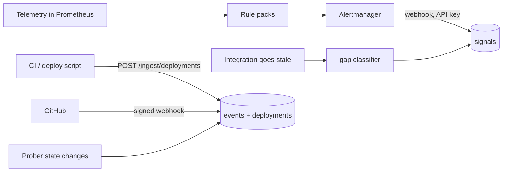

# Detection: signals, deployments, and change events

SENTINEL turns telemetry and outside events into two kinds of record:

- **Signals:** something may be wrong, for example a service failing requests,
  a disk filling up, an endpoint down, or a source gone quiet. Signals are
  grouped into incidents in Step 12.
- **Events:** something changed, for example a deployment, a code push, a CI
  run, a probe changing state, or an integration's health changing. Events are
  what an investigation looks at to answer "what changed?".



## Rule packs

The rules live in `deploy/prometheus/rules/packs/`, one file per entity type.
They're written against labels only, so a new host, container or service is
covered as soon as its data arrives.

| Pack | Alerts |
|---|---|
| host | `HostHighCpu` (> 90%, 10 min), `HostMemoryLow` (< 10% available), `HostFilesystemFull` (> 90%), `HostFilesystemFillingUp` (full within 4 h at the last 30 min's rate), `HostInodesHigh`, `HostWatchedProcessAbsent`, `HostNetworkErrors` |
| container | `ContainerRestarted`, `ContainerMemoryNearLimit` (only containers that have a limit), `ContainerCpuThrottled` |
| service | `ServiceHighErrorRatio` (> 5% 5xx with real traffic, 1-minute window), `ServiceLatencyHigh` (p95 > 1 s **and** over twice its 1-hour baseline), `ServiceThroughputCollapse` (< 20% of the last hour) |
| database | `DatabaseConnectionsHigh`, `DatabaseDeadlocks`, `DatabaseReplicationLag` (for the PostgreSQL receiver, when it's configured) |
| endpoint | `EndpointDown` (every result in 2 minutes failed, at least 2), `EndpointSlow`, `EndpointCertExpiringSoon` (< 14 days) |
| integration | `AgentExportFailing`, `AgentQueueNearlyFull` (from the agent's own metrics) |

Every alert carries `severity`, `pack`, `entity_type` and the entity's
identifying labels (`host_name`, `container_name`, `service_name`,
`sentinel_check_id`, …), plus a one-line `summary`.

`make test-rules` runs promtool on all of them. Every alert has a test that it
fires, and the packs' tests include cases that must stay quiet:
- a healthy second host;
- a single failed check;
- a service that is always slow (above 1 s, but that's its normal);
- a 3× traffic spike;
- an unlimited container;
- the gateway's own Collector, as opposed to an agent.

## Signals

`GET /api/v1/signals?status=firing&kind=&service=&entity=&since=` (any signed-in role)

| Kind | From |
|---|---|
| `prom_alert` | A rule-pack alert, via Alertmanager. One signal per *episode*: the same alert firing again later is a new signal. Repeats and retries update it. A resolved signal is never re-opened by a late delivery |
| `telemetry_gap` | An integration went `stale` (below) |
| `error_group_new`, `error_group_spike` | Step 11 (log error grouping) |

Signals are linked to the inventory entity they're about. The lookup checks, in
order: the health check, then the container, the service, and the host.

### Telemetry gaps: agent problem, or host down?

A source going quiet doesn't say *why*. SENTINEL uses what else it can see,
mainly external checks of the same machine:

| Source | Endpoint checks of that machine | Classification | Severity |
|---|---|---|---|
| agent | all pass | agent problem | info |
| agent | any fails | host or network down | critical |
| agent | none | host or agent (unknown) | warning |
| app, webhook, … | — | source stopped sending | warning |

The classification is updated as probes change. The signal resolves when data
flows again. A check "covers" a machine when its target host matches a host or
container name that the agent reported.

## Deployments

```bash
curl -X POST https://sentinel.example.com/api/v1/ingest/deployments \
  -H "X-Sentinel-Key: $SENTINEL_DEPLOY_KEY" -H "Idempotency-Key: deploy-$GIT_SHA-orders" \
  -H 'Content-Type: application/json' \
  -d '{"service": "orders", "version": "v1.4.0", "commit_sha": "'$GIT_SHA'",
       "image_ref": "registry/orders:v1.4.0", "environment": "prod", "deployed_by": "ci"}'
```

- **Key:** create an API key with the `deployments:write` scope (`POST /api/v1/api-keys`).
- **Duplicates:** `Idempotency-Key` makes retries safe. Without it, an identical body is still recorded only once.
- **Response:** `201` for a new deployment, `200` for a repeat.
- **What's stored:** each deployment is a `deployment` event plus a row in `GET /api/v1/deployments?service=&since=`, linked to the service entity. `previous_commit_sha` is filled from the last successful deployment.
- **AVIRO:** run `make up-sentinel TOKEN=… DEPLOY_KEY=…` once. After that, `make deploy REF=…` reports every rollout.

## GitHub

The webhook is `POST /api/v1/ingest/github`, with the secret in
`SENTINEL_GITHUB_WEBHOOK_SECRET`:

- **Content type:** `application/json`.
- **Events:** *Pushes*, *Deployment statuses* and *Workflow runs*.

| Event | Becomes |
|---|---|
| `deployment_status` | A deployment (`source: github`). Later statuses update it: `success` → `succeeded`, `failure`/`error` → `failed` |
| `push` | A `push` event: the ref, before and after commits, and up to 20 commits with the first line of each message, with secrets redacted |
| `workflow_run` (`completed`) | A `workflow_run` event. A failure is `warning` |
| `ping` | Nothing stored (`pong`) |

How it's protected:
- **Signature:** every delivery's `X-Hub-Signature-256` is checked against the raw body. A wrong or missing signature gets `401`.
- **Duplicates:** deliveries are de-duplicated by `X-GitHub-Delivery`.
- **Size:** bodies over 5 MB are refused.
- **No secret configured:** the endpoint answers `401` with "not configured".

## Alertmanager

Alertmanager sends to `/api/v1/ingest/alertmanager` with an API key whose only
scope is `alerts:write`. SENTINEL creates this key itself on startup and writes
it to a volume that only Alertmanager mounts. A valid key is kept, and an
invalid one is replaced.

Grouping is per alert and entity, with `group_wait` set to 10 s, so a new
alert reaches SENTINEL quickly.

## How fast

| Scenario | Measured |
|---|---|
| S01 (a deploy makes `POST /api/orders` fail) | Signal **130 s** after the bad release went live (191 s from the start of `make deploy`, which includes a 60 s image build). Resolved 110 s after the fix went live |
| Synthetic 20% 5xx burst (`tests/gateway/test_detection_e2e.py`) | Signal 105 s after the fault (locally), then resolved |
| Normal load, 30 minutes (AVIRO, 20 shoppers, 63,448 requests) | No signals |
