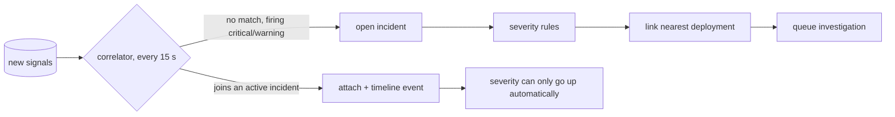
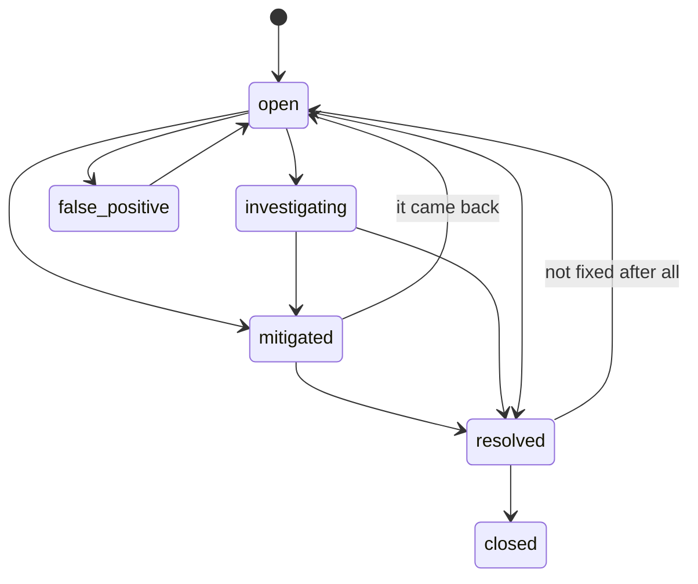

# Incidents: correlation, severity, lifecycle and timeline

An incident is one problem, however many signals it raises. A bad deploy of
`orders`, for example, gives:
- a new or spiking error group in `orders`;
- a 5xx alert on `orders`;
- a 5xx alert on the `gateway` in front of it.

That's three signals and **one** incident, linked to the deployment.

## How signals are grouped

A new signal joins an **active** incident (`open`, `investigating` or
`mitigated`) whose last signal was within the last **15 minutes**. The first
of these that holds decides, and is recorded as the signal's `reason`:

| Reason | When |
|---|---|
| `same_entity` | The incident already involves the signal's entity (service, host, container, endpoint) |
| `same_service` | Same service name, for a signal without an inventory entity |
| `related_entity` | The entities are linked in the topology, either way round, within 3 hops of `runs_on`, `uses` or `fronts`: a host and a service running on it, or a service and one it calls |
| `shared_trace` | The signal and the incident share a trace ID (from error groups) |
| `deploy_window` | The incident's suspected deployment also shipped this signal's service (same commit), within an hour |

**Two services that merely share a host are not related.** Their faults stay
separate incidents. A fault *of* that host (disk full) joins either.

**When nothing matches,** a *firing* `critical` or `warning` signal opens a new
incident. These never open one, but can join one:
- an `info` signal, such as "agent problem, host up";
- a signal that has already resolved.

### Where the topology comes from

| Relation | Source |
|---|---|
| service `runs_on` container, container `runs_on` host | Telemetry resource attributes (entity discovery, Step 8) |
| service `uses` service | The trace store's call graph: who called whom in the last hour. It's refreshed every 2 minutes, and services are matched by name within one environment |

## Severity

| Rule | When | Result |
|---|---|---|
| R1 | The worst signal is `critical` / `warning` / `info` | SEV2 / SEV3 / SEV4 |
| R2 | A `critical` signal **and** one of these: ≥ 50% of a service's requests fail; ≥ 3 services are involved; an involved entity has criticality `critical` | SEV1 |
| R3 | ≥ 2 services are involved, or an entity has criticality `high` | One level more severe. On its own, R3 never makes SEV1 |
| R4 | Every involved entity has criticality `low` | One level less severe |

The rules run when an incident opens and each time a signal joins it.
**Automatically, severity only goes up.** Each change is on the timeline, with
the rule that caused it. A person can set any severity.

## Lifecycle

`false_positive` is reachable from every state. A move the diagram doesn't
allow gets `409`.

SENTINEL itself changes the status in two cases:
- **Mitigated:** every signal has been resolved for 5 minutes. The wait stops a signal that resolves and fires again from flipping the status.
- **Open again:** a new firing signal joins a mitigated incident.

People resolve and close.

## Nearest deployment

When an incident opens, SENTINEL links the latest deployment of its service
(or its entities) in the hour before it started. Two cases need extra rules:
- **Stamped at the end of the rollout:** a deployment stamped up to 2 minutes
  *after* the start still counts. Deploy scripts often stamp the end of the
  rollout, but errors begin during it.
- **Reported late:** if the deployment event arrives after the incident opened
  (a CI job reporting at the end), SENTINEL keeps looking for 30 minutes.

## Timeline

`GET /api/v1/incidents/{id}/timeline` lists every event, oldest first:
- `opened`
- `signal_attached`, with the reason
- `deployment`
- `severity_changed`, with the rules or the person
- `status_changed`, with an optional note
- `investigation_queued`
- `comment`

The table is append-only. A database trigger rejects updates, and the
application's database role can't update or delete rows.

## API

| Method | Path | Who |
|---|---|---|
| GET | `/api/v1/incidents?status=&severity=&service=&cursor=&limit=` | Any signed-in role. Newest first. Page with `cursor` set to the last `number` you got |
| GET | `/api/v1/incidents/{id}` | Any signed-in role. Includes the entities (origin/affected), the signals with their reasons, and the suspected deployment |
| PATCH | `/api/v1/incidents/{id}` `{status, severity, title, note}` | Responder and up. Written to the audit log |
| GET | `/api/v1/incidents/{id}/timeline` | Any signed-in role |
| POST | `/api/v1/incidents/{id}/comments` `{text}` | Responder and up |

## Investigations

Each new incident queues one `investigate` job, on the `investigations` queue
of the jobs table. The AI investigator that runs these jobs arrives in Step 17.
Until then the job stays queued, and the timeline says "investigation queued".
