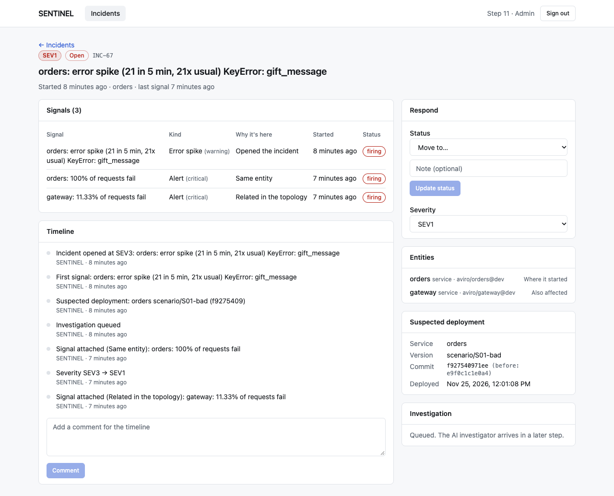

# Step 13 report — Frontend foundation: login, incidents, timeline

**Status:** 🟡 built and tested locally; CI results pending.
**PR:** (link added after opening).
**Date:** 2026-11-25

## What was built

| Area | Files |
|---|---|
| App shell | `frontend/src/App.tsx`, `routes.tsx`, `queryClient.ts`: React Router (v8), TanStack Query. An expired session (any 401) sends you back to sign in, then returns you to where you were |
| Auth | `src/auth/`: who's signed in and their permissions (from `/api/v1/auth/me`), sign in, sign out, and a guard for signed-in pages |
| Generated API client | `src/api/openapi.json` and `src/api/schema.d.ts`, generated from the backend (`make api-client`, new `sentinel openapi` command). `src/api/client.ts`: `openapi-fetch` over those types, with the CSRF double-submit header on every non-GET request |
| Pages | `/login`; `/incidents`; `/incidents/:id`. The list: filters in the URL, refresh every 10 s, cursor paging. The detail: signals with the reason each joined, entities, suspected deployment, timeline, and role-aware controls (status, severity, comment) |
| Components | `src/components/ui/` (button, badge, card, fields: shadcn-style, on Tailwind 4), `src/components/incidents/` (badges, timeline, signals table, entities and deployment, controls) |
| Serving | `deploy/caddy/web.Caddyfile` and a `web` service (compose profile `web`): the built app and the API on one origin, at **http://127.0.0.1:3000** (`make ui`). Strict CSP and security headers |
| API | The client IP is believed from `X-Forwarded-For` only on requests that carry Caddy's internal secret (bug 1). The incidents timeline schema is renamed `TimelineEventOut` (a clean generated type) |
| Tests | `src/App.test.tsx` (14 component tests), `e2e/incidents.spec.ts` (3 Playwright tests against the real stack), `make test-e2e`, and a new `ci-e2e` workflow. Frontend CI also checks that the generated types match the schema, and a backend test checks the committed schema is current |
| Docs | [Web UI guide](../guides/web-ui.md); [local setup](../guides/setup-local.md) |

## Acceptance criteria (roadmap)

| Criterion | Result |
|---|---|
| A viewer can't change status | ✅ **In the UI:** a viewer gets no status, severity or comment control, only "Your role can view incidents but not change them" (component test and Playwright). **In the API:** in the browser test, the viewer's own session and CSRF token sending `PATCH {status: resolved}` gets **403**, and the incident stays open |
| The E2E test passes | ✅ Locally, 3 of 3 Playwright tests against the real stack. Real accounts: an admin from the CLI, a viewer and a responder through invites. Real incidents: alerts posted to Alertmanager, through the webhook, signal and correlator. The tests cover:<br>• the viewer signs in, **watches a new incident appear in the list without reloading**, opens it, and can't change it;<br>• the responder moves it to Investigating with a note and comments, and the timeline records both;<br>• a stored-XSS payload in an alert renders inert under the real CSP: no `` or `<script>` created, no script run, no dialog.<br>⏳ CI (`ci-e2e`) |
| How you verify: log in, trigger S01, watch the incident appear | ✅ Real AVIRO under load from 20 synthetic shoppers, `make deploy REF=scenario/S01-bad`: INC-67 opened **24 s** after the deployment's rollout-start stamp, at SEV1, with three signals:<br>• the `KeyError` error spike;<br>• `orders` 100% failing;<br>• the gateway's 11% 5xx, joined through the topology.<br>Both entities, the S01-bad deployment and the full timeline are on the page:  |

Its title is its first signal's: here the error spike, which in the fast test stack arrived before the 5xx alert.

## Test results

| Suite | Result |
|---|---|
| Frontend: lint (oxlint), format, typecheck, build | Clean. Bundle 413 kB (129 kB gzipped) |
| Frontend component tests (Vitest) | 14 passed |
| Playwright (local Chrome, fast stack, real UI on :3000) | 3 passed |
| `make test-all` (backend) | 703 passed, coverage 93.7% |
| CI | pending |

**Checking that the tests can actually fail.** I broke four things, and a test failed each time:
- the controls shown to every role;
- the title rendered as HTML (component test, and Playwright against a real build);
- the CSRF header dropped (two tests).

## Bugs found and fixed during this step

1. **Behind the new web proxy, every user would have shared one IP.** The API took the client address from the TCP peer, which behind Caddy is always Caddy. Logins are limited to 5 a minute per IP, so five sign-ins a minute across all users would have locked everyone out, and the audit log would have recorded Caddy's address for every action. The API now believes `X-Forwarded-For` only on a request carrying the internal secret that Caddy adds. A browser can send neither header through Caddy (Caddy replaces both), and a direct caller's are ignored. Checked live:
   - through Caddy from another container, the audit log records that container's address, and a spoofed `X-Forwarded-For` is ignored;
   - a forged secret with a spoofed address is ignored too.
2. **Port clash with the demo shop.** The UI was first on `:8080`, which AVIRO's gateway uses, so `make up-sentinel` failed. It's on `:3000` now.
3. **Stale builds were served without anyone noticing.** A temporary screenshot script broke the type-check, so `npm run build` failed and the old bundle kept being served while I thought I was testing the fix. Caught by measuring the layout instead of trusting the screenshot. `make ui` stops on a failed build.
4. **The detail page scrolled sideways on a phone** (126 px). Grid columns default to `min-width: auto`, so the signals table widened the page instead of scrolling inside its card. Measured at 390 px wide, fixed, and re-measured at 0 px.
5. **A misleading timeline line:** "Signal attached (Opened the incident)" now reads "First signal: …".

## Decisions worth reviewing

1. **A separate `web` Caddy for the UI, on port 3000**, not the ingest Caddy (`:4319`). The ingest endpoint stays OTLP-only, as designed. It's opt-in (`make ui`, compose profile `web`), because it needs the built frontend.
2. **The client-IP rule** (bug 1) reuses the internal secret the ingest Caddy already sends, instead of trusting a network range. It works however containers are addressed, and can't be forged from outside.
3. **`openapi-typescript` runs as a pinned tool** (`npx`, with its own TypeScript 5), not a project dependency. It needs TypeScript 5's compiler API, and the project is on TypeScript 7. The generated files are committed and checked in CI.
4. **shadcn/ui style, written by hand.** The handful of primitives needed (button, badge, card, fields) are small local files on Tailwind 4, with `@radix-ui/react-slot` only. There's no generator, and no Radix components until something needs them. Selects are native, for accessibility and fewer dependencies.
5. **Polling every 10 s, not server-sent events,** for incidents and timelines. SSE is planned for investigation progress (Step 17).
6. **The test stack's login limit is raised to 60 a minute** (`make stack-up-fast` only), because one E2E run signs in about 6 times from one address. Production keeps 5.

## Known limitations

- **The timeline shows "A person" for other people's actions, and "You" for yours.** Names need a user lookup that viewers are allowed to make. That's a later addition.
- **The investigation card is a placeholder** until the investigator (Step 17).
- **Locally, every browser has the same address:** rootless Podman's port forwarding makes browser connections look like they come from Caddy's own container. Deployed, real addresses pass through (bug 1 shows the mechanism working).
- **No HSTS yet:** that comes with TLS (the AWS step).
- **Light and dark follow the system setting;** there's no toggle.

## How you verify

```bash
cd "/Users/asadsheikh/Coding/SENTINEL Autonomous AI Site Reliability Engineer"
git checkout step-13-frontend
make stack-up && make ui          # then open http://127.0.0.1:3000 and sign in
cd ../aviro-shop && make up-sentinel TOKEN=sit_... DEPLOY_KEY=sk_live_... && make load USERS=20
make deploy REF=scenario/S01-bad  # the incident appears in the list within a few minutes, no reload
# Tests:
cd ../"SENTINEL Autonomous AI Site Reliability Engineer"/frontend && npm test
cd .. && make stack-up-fast && make ui && make test-e2e
```

## Not in this step (by design)

- Integrations UI: catalogue, setup wizard, inventory (Step 14).
- Evidence, hypotheses, patches and approvals views (later steps).
