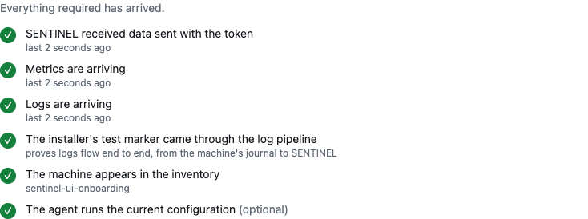

# Step 14 report — Integrations UI: catalogue, setup wizard, verification, health, inventory

**Status:** 🟡 built and tested locally; CI results pending.
**PR:** (link added after opening).
**Date:** 2026-11-25

## What was built

| Area | Files |
|---|---|
| Catalogue | `frontend/src/components/integrations/catalogue.ts`, `pages/integrations/CataloguePage.tsx`: the MVP tiles are Linux host, Container host, Python app, HTTP check, Deployment webhook and Alertmanager. GitHub is shown, but not available until the repository steps |
| Wizard | `pages/integrations/WizardPage.tsx`: configure → the ingest token (or, for webhooks, an API key) shown **once** → instructions for that kind → a live checklist, polled every 3 s. HTTP checks create the integration and the check; a refused URL gets the server's reason |
| Instructions | `components/integrations/Instructions.tsx`:<br>• **Host:** save the token to a file, then run the installer with `--token-file` (never on a command line), or the container command.<br>• **App:** the OpenTelemetry install and environment.<br>• **Deployments:** a CI `curl` step.<br>• **Alertmanager:** a receiver whose key is read from a file |
| Integrations | `pages/integrations/IntegrationsPage.tsx`: health tiles (healthy, degraded, stale, waiting for data), what needs attention (the first 5, then a count), and the list. `IntegrationDetailPage.tsx`: checklist, signals, what it discovered, setup instructions; for admins, token rotate (new token shown once), revoke, and disable |
| Inventory | `pages/InventoryPage.tsx`: entities by type and name, which integration reports each, last seen (flagged after 10 minutes), relations on demand ("runs on", "calls", marked "from traces") |
| Backend: verification | `integrations/verification.py`: the checklist per kind. Token used; each expected signal; the installer's marker in Loki; host, container or service entities; the agent's reported config hash in Prometheus; the first probe. `GET /integrations/{id}/status` returns it (any role), with 3 s limits on the store lookups. A store that's down leaves its item unticked; it isn't an error |
| Backend: other | Migration 0008 `integrations.verified_at` (the marker is looked up only until it's found); `GET /entities?integration=`; `ingest_endpoint` in `/api/v1/meta` |
| Tests | `src/integrations.test.tsx` (9 component tests), `e2e/onboarding.spec.ts` (2 Playwright tests), `tests/db/test_verification.py` (4). The `ci-e2e` job now builds a disposable machine for the Linux-host test |
| Docs | [Web UI guide](../guides/web-ui.md): pages, adding an integration, the checklist per kind |

## Acceptance criteria (roadmap)

| Criterion | Result |
|---|---|
| Testing: E2E: create a Linux-host integration → the (containerised) agent installs → checklist ticks → host visible in inventory | ✅ Locally, Playwright against the real stack:<br>1. An admin creates a Linux-host integration in the wizard.<br>2. The test copies **the token and the install command off the page**.<br>3. On a fresh Ubuntu 24.04 systemd machine, it does exactly what the page says: saves the token to a file, then runs the installer, pointed at that machine's way in to SENTINEL.<br>4. Every required item on the same page ticks, with no reload: token used, metrics, logs, the installer's marker through the log pipeline, and the machine in the inventory. The optional "current configuration" item ticks too.<br>5. The machine is then found in the Inventory page.<br>About 30 s once the machine image is cached.  ⏳ CI (the installer downloads the agent there, as for a user) |
| A new user can onboard a Linux VM and an HTTP check using only the UI instructions (**dry run with you as the tester**) | Automated proxy ✅. The test above (Linux host), plus "an HTTP check, set up from the UI, shows its first probe": it ticks "The first probe ran" with the result `up`. **Your dry run is still to do** (see "How you verify"). It's a person following the page, which no test can stand in for, and it's the real acceptance |

## Test results

| Suite | Result |
|---|---|
| Frontend: lint, format, typecheck, build | Clean |
| Component tests (Vitest) | 23 passed (14 from Step 13, 9 new) |
| Playwright (real stack, local Chrome) | 5 passed: 3 incident tests, plus HTTP-check and Linux-host onboarding |
| `make test-all` (backend) | 707 passed, coverage 93.8% |
| CI | pending |

## Bugs found and fixed during this step

1. **The header was 77 px wider than a phone** on every page once the nav had three links. Measured at 390 px wide; the nav now scrolls on its own, and every page measures 0 px.
2. **The Copy button covered the install command** where it wraps. It's now above the block.
3. **The "needs attention" list could run to dozens of rows** (this dev stack has 26 stale integrations left by earlier agent tests). It shows 5, then a count.
4. **`SENTINEL_AGENT_PUBLIC_ENDPOINT` never reached the API container**, so the wizard always showed `http://127.0.0.1:4319`, which a separate VM can't use. Found while writing the dry-run steps; compose now passes it through.
5. **The checklist's times were raw ISO timestamps** ("last at 2026-11-25T07:59:10.336098+00:00"). The API returns the time as its own field, and the UI shows "last 2 seconds ago", with the exact time on hover.

## Decisions worth reviewing

1. **Only admins can add or change integrations, and every role can see them.** That's the existing permission split (`integrations:manage`, `apikeys:manage`).
2. **Deployment webhook and Alertmanager tiles create a scoped API key**, not an integration: that's how those endpoints authenticate (Step 10). Their checklist is "a request arrived with this key".
3. **The marker check is remembered** (`verified_at`), so Loki is queried only until it's found.
4. **The checklist is computed on request**, polled every 3 s while the wizard is open (every 10 s on the detail page). There's no background job.
5. **The Linux-host E2E is opt-in locally** (`SENTINEL_E2E_AGENT=1`), because it needs the machine image from `make test-agent`. It's always on in CI.
6. **The Python app instructions use OpenTelemetry's standard auto-instrumentation** (`opentelemetry-instrument`). They also say how to send through a local agent instead, with no token.

## Known limitations

- **There's no in-place editing of an agent's options** (processes, log files). Change them by creating a new integration, or wait for a later edit form; the API's `PATCH` already supports it.
- **Node app, PostgreSQL, Cron job, AWS and Upload tiles** are not in the MVP catalogue (they're Should items).
- **The "service name missing" warning** from the design (§5.3) isn't shown yet. A service without one appears as its container's name instead (Step 8 behaviour).

## How you verify (your dry run)

On a Linux VM (Lima on your Mac, or any Ubuntu 22.04/24.04, Debian 12/13 or Amazon Linux 2023), with SENTINEL running:

```bash
cd "/Users/asadsheikh/Coding/SENTINEL Autonomous AI Site Reliability Engineer"
git checkout step-14-integrations-ui
# The address the VM uses to reach your Mac's ingest endpoint (shown in the wizard).
# For Lima, the guest reaches the Mac's localhost as host.lima.internal:
export SENTINEL_AGENT_PUBLIC_ENDPOINT=http://host.lima.internal:4319
make stack-up && make ui            # http://127.0.0.1:3000, sign in as admin
```

1. **Linux VM:** Integrations → Add integration → Linux host. Name it, then follow the page on the VM.
   - The VM must reach SENTINEL's ingest endpoint: that's what `SENTINEL_AGENT_PUBLIC_ENDPOINT` is for. I believe Lima's `host.lima.internal` reaches the Mac's localhost, but I haven't tried it with this stack. If it doesn't, use any address the VM can reach that leads to port 4319.
   - Watch the checklist tick, then find the VM under Inventory.
2. **HTTP check:** Add integration → HTTP check, with a public URL (for example `https://example.com`). Watch "The first probe ran".

## Not in this step (by design)

- GitHub (repository steps).
- Editing agent options in the UI; the remaining catalogue tiles (Should items).
